<p align="center"></p>

<h1 align="center">secret-desk</h1>

<p align="center">
A local-first portal that shows what expires when, issues new tokens at the providers, lets a human review and confirm each new value, and only then writes it straight into GitHub. Secret values are never stored.
</p>

<p align="center">
  <a href="https://github.com/Pineflight/secret-desk/actions/workflows/ci.yml"></a>
  <a href="LICENSE"></a>
  = 24">
</p>

<p align="center">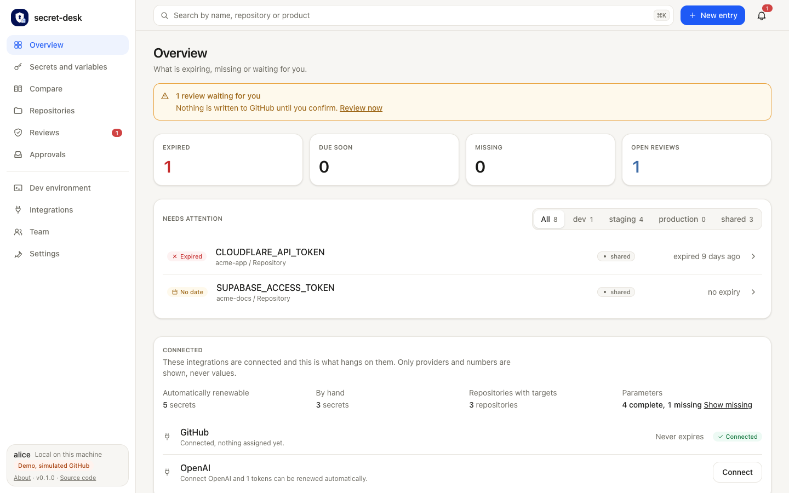</p>

## Contents

- [Why secret-desk](#why-secret-desk)
- [Features](#features)
- [Screenshots](#screenshots)
- [Working .env.local in one command](#working-envlocal-in-one-command)
- [Architecture](#architecture)
- [Quick start](#quick-start)
- [Docker](#docker)
- [Security principles](#security-principles)
- [Platforms](#platforms)
- [Documentation](#documentation)
- [Project status](#project-status)
- [Roadmap ideas](#roadmap-ideas)
- [Contributing](#contributing)
- [License](#license)

## Why secret-desk

Teams that deploy through GitHub Actions end up with tokens, API keys and webhook secrets spread over many repositories and environments. Three things go wrong again and again:

- **Nobody knows what expires when.** A Cloudflare token runs out on a Friday evening and the deploy workflow turns red.
- **Creating the new value is manual and error-prone.** Someone opens the provider dashboard, clicks through a form, copies the value, and pastes it into several places, sometimes the wrong stage.
- **Nobody checks the new value before it goes live.** And the old one is forgotten at the provider.

secret-desk closes these gaps without becoming a second secret store:

- **Expiry overview.** Every secret and variable is listed by stage and status, with owner, description and links.
- **Provider issuance through APIs.** Where a provider has an API, the portal generates the new value for you.
- **Review and confirm before GitHub.** The new value is verified (function test, permissions, expiry, targets reachable) and summarized in a review report with an evidence image. A human ticks the review items. Only then is the value written to GitHub and the old one revoked. Rejecting deletes the new value at the provider again.
- **Values are never stored.** They live in memory for at most 15 minutes and are passed on in exactly two places: the provider API and, encrypted, GitHub.

## Features

- **Task-first screens:** every page puts its main action in the first viewport. Dialogs have a fixed footer with submit and cancel, and *New entry* asks for the required fields first. See the [UI guide](docs/UI-GUIDE.md).
- **Expiry overview:** secrets listed by stage and status (ok, soon, due, expired, missing), with description, owner, link and tags. A daily workflow can raise expiry reminders as GitHub issues (`secret-desk check`, [examples/workflows](examples/workflows/secret-desk-expiry.yml)).
- **Two-stage issuance with review evidence:** generate at the provider, verify, review report plus evidence image, human confirmation (optionally with your own screenshot), then write. Providers without an API use the same flow with a manual paste. See [Architecture](docs/ARCHITECTURE.md#the-path-of-a-new-value).
- **Configurable stages:** define your own stages (default `dev`, `staging`, `production`, `shared`). Behavior follows the stage `kind`, not its name. See [Stages](docs/STAGES.md).
- **Variables (`vars.*`):** configuration values with an expected value that is compared with GitHub and applied on request. A guard stops secrets from ending up as variables.
- **Compare across stages and all repositories:** one matrix of secrets and variables against stages, with live read-only checks against GitHub, repositories without inventory entries, what workflows need (`secrets.*`/`vars.*`), orphans and renamed repositories. See [Compare](docs/COMPARE.md).
- **Repositories and local links:** link repositories to folders on your machine (links never leave it). See [Repositories](docs/REPOSITORIES.md).
- **Parameters and resource selection:** each provider declares what an entry needs (account, project, zone, domain). The portal lists the resources of the connected integration read-only, suggests at most one match that you confirm with a click, blocks issuing while required parameters are missing and runs a read-only preflight. Variables can load public values (project URL, zone id, sitekey) from a provider. See [Parameters and resources](docs/RESOURCES.md).
- **One card per provider:** the Integrations page and picker group GitHub, Stripe, Cloudflare, Supabase, Resend, RevenueCat, Grafana, OpenAI and more by category with their logos; under a card the ways in are sign-in (browser), API keys (created by the sign-in where there is one) and by hand. See [Integrations](docs/INTEGRATIONS.md#one-card-per-provider).
- **Integrations with permission guides:** for each provider the exact permissions to grant, a link that prefills the GitHub token form, a read-only **Test connection** and an opt-in **write test**. See [Integrations](docs/INTEGRATIONS.md).
- **Encrypted vault for integration tokens:** optional, AES-256-GCM, key in the OS keychain (macOS Keychain, Linux `secret-tool`, Windows DPAPI) or a key file.
- **Browser automation recipes:** for providers without an API, a browser walks through the form from a YAML recipe: a local Chrome, or a browser sidecar on a server that you reach through noVNC, sign in to once, and that later runs use without anyone watching. Sign-in, 2FA and CAPTCHA stay with the human. See [Recipes](docs/RECIPES.md) and [Browser on the Pi](docs/DOCKER.md#browser-on-the-pi).
- **Runs on a small server:** the portal and the browser sidecar run as containers on a Raspberry Pi in your LAN, behind a reverse proxy, updated automatically. See [Docker](docs/DOCKER.md).
- **Full sync in one pass:** read what every workflow needs, normalize names, create every value a provider can create and load every variable from its source, then write all of it. See [Full sync](docs/FULL-SYNC.md).
- **Dev `.env` export:** per-repository templates produce a working `.env.local` on demand (defaults, random values, VAPID pairs, prefixed secrets, personal dev tokens, variables, keys of the local Supabase stack, values shared between repositories, optional inputs) with mode 600, stored nowhere. See [below](#working-envlocal-in-one-command) and [docs/DEV-ENV.md](docs/DEV-ENV.md).
- **Search and command palette:** ⌘K / Ctrl K opens a palette over secrets, variables, repositories, stages, integrations, providers, pages and actions (metadata only, never values) with typo-tolerant matching, filters such as `stage:staging`, suggestions and recent items. See [Search](docs/SEARCH.md).
- **Team file and team sync:** export the configuration without values so new team members import it and start, or keep it in a private GitHub repository: the portal offers it at the first start (load from GitHub, upload a file or start empty), shows a preview before taking anything over and pushes changes back as a pull request after you confirm. See [Team](docs/TEAM.md).

### Supported integrations

The overview page shows which integrations are connected, what hangs on them and how many secrets can be renewed automatically. Details per provider: [Providers](docs/PROVIDERS.md).

| Integration | Created through the API | Loaded as variables | In a browser (recipe) |
|---|---|---|---|
| Local | random hex, base64 and UUID values | n/a | n/a |
| Cloudflare | API tokens, Turnstile secrets | account id, zone id, Turnstile site key | n/a |
| Supabase | API keys, service role key (read) | project ref, URL, publishable key | access tokens (scaffold) |
| Stripe | webhook signing secrets (sandbox and live, per account) | n/a | restricted keys (per account and mode) |
| Resend | domain-limited sending keys | domain id | n/a |
| Grafana | service account tokens | n/a | n/a |
| GitHub | n/a (it is where values are written) | n/a | fine-grained tokens (scaffold) |
| RevenueCat | n/a (no key API) | project id, app ids, SDK and sandbox keys | secret API keys through the guided sign-in (key run verified live; sign-in form steps after the email not) |
| Anything else | n/a | n/a | you paste it, the portal verifies and writes it |

Cloudflare tokens and Turnstile secrets, Supabase secret keys, Stripe sandbox webhooks and Resend keys were verified against the live services in a full rollout on 2 November 2026; the rest is tested against mocks. What is supported, in progress and planned, and which external services secret-desk talks to: [Providers and roadmap](docs/ROADMAP.md). Per endpoint: [Providers](docs/PROVIDERS.md).

- **MCP server, skill and agent HTTP API:** AI agents maintain metadata, query status and request renewals. They never see values and never confirm. See [Agents](docs/AGENTS.md) and the [Agent API](docs/AGENT-API.md).
- **German and English UI**, runs on **macOS, Linux and Windows**.

## Screenshots

All screenshots come from the built-in demo (simulated GitHub, made-up data) and are produced by `pnpm docs:screenshots`.

| | |
|---|---|
| [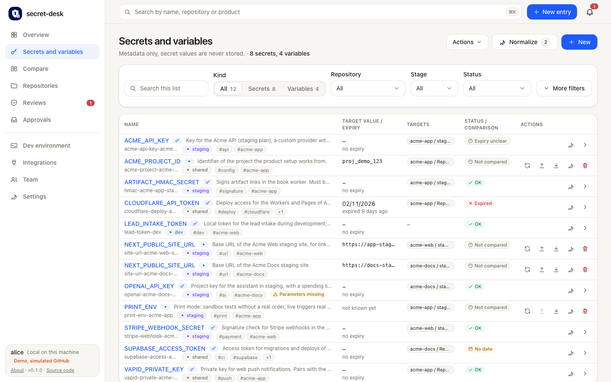](docs/images/entries.png)<br>**Secrets and variables:** one list, one toolbar (search, kind, repository, stage, status; more filters behind a button) | [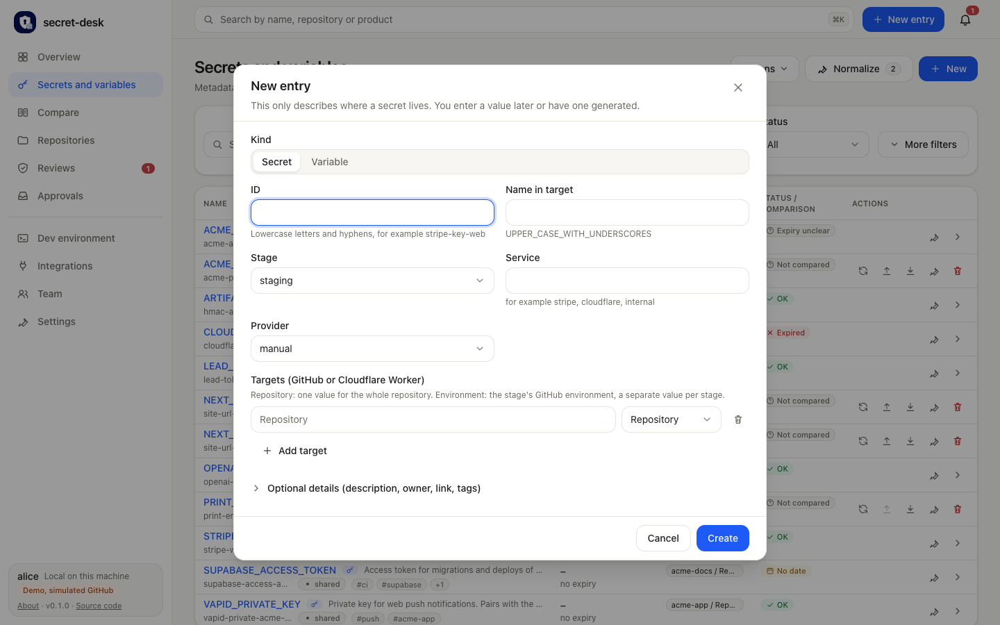](docs/images/new-entry.png)<br>**New entry:** required fields first, optional details in a closed section, fixed *Create* / *Cancel* footer |
| [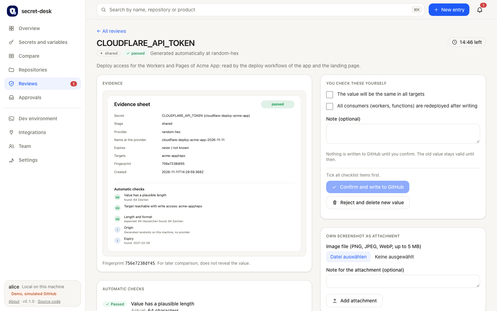](docs/images/review-detail.png)<br>**Review:** evidence image, checklist, confirm or reject in a sticky action bar | [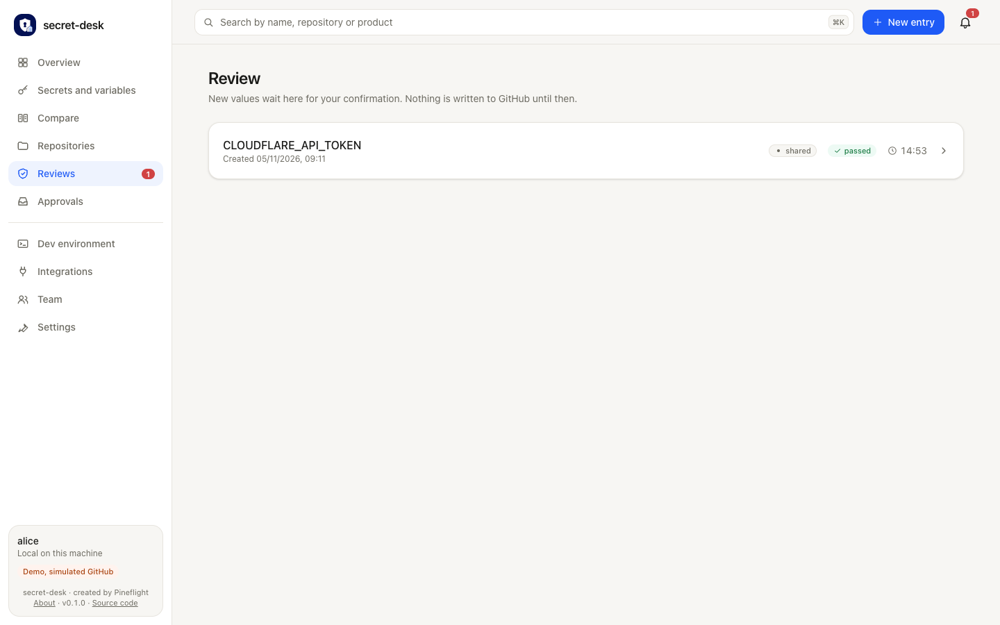](docs/images/reviews.png)<br>**Reviews:** open reviews waiting for a human |
| [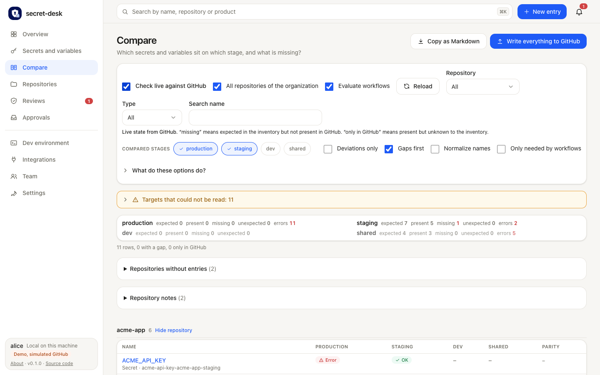](docs/images/compare-live.png)<br>**Compare:** one toolbar with the live toggle, a compact summary strip, *Write everything to GitHub* and *Copy as Markdown* in the header | [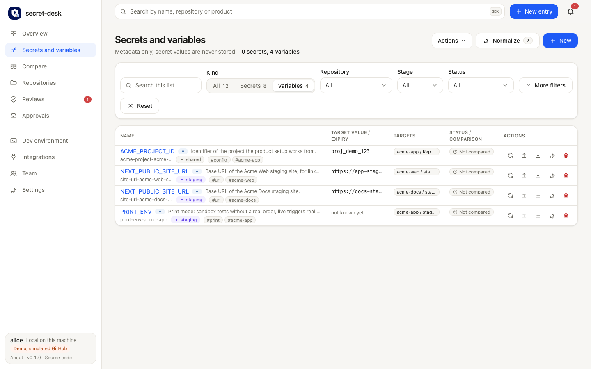](docs/images/variables.png)<br>**Variables:** the same list with *Kind: Variables*, expected value against GitHub |
| [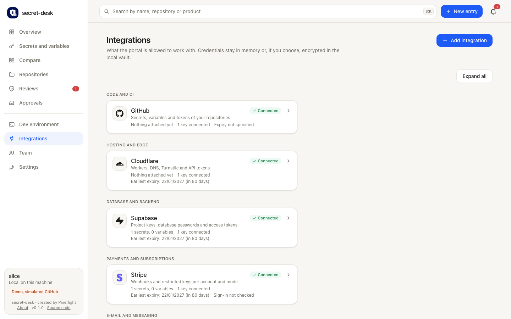](docs/images/integrations.png)<br>**Integrations:** a compact live check bar and one card per provider in a grid | [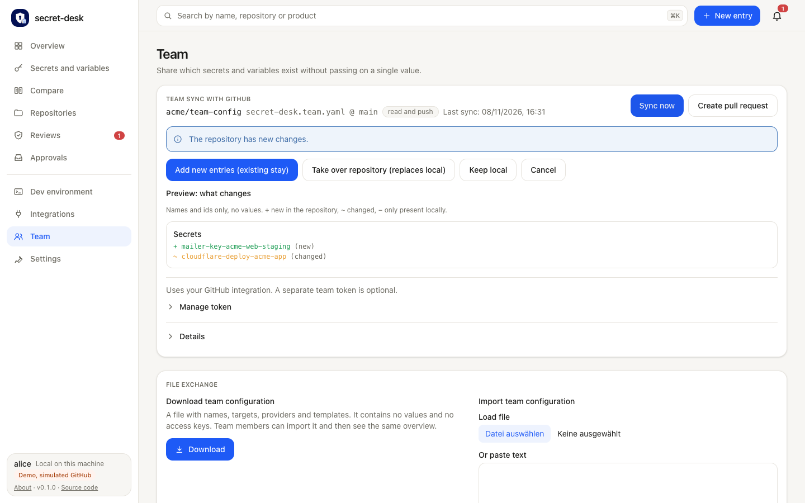](docs/images/team.png)<br>**Team:** team sync with GitHub and one *File exchange* card |
| [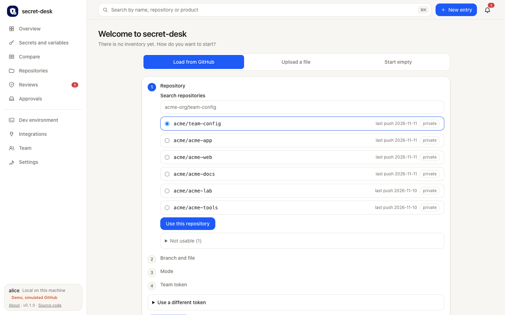](docs/images/setup.png)<br>**First start:** load the team configuration from GitHub, upload a team file, or start empty | [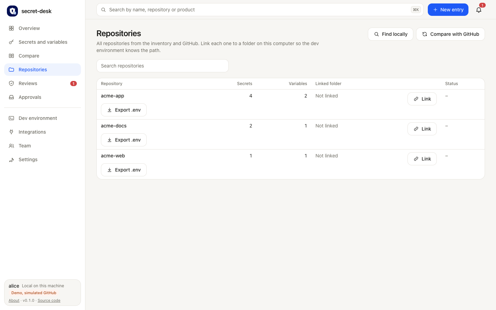](docs/images/repositories.png)<br>**Repositories:** link folders on this machine |
| [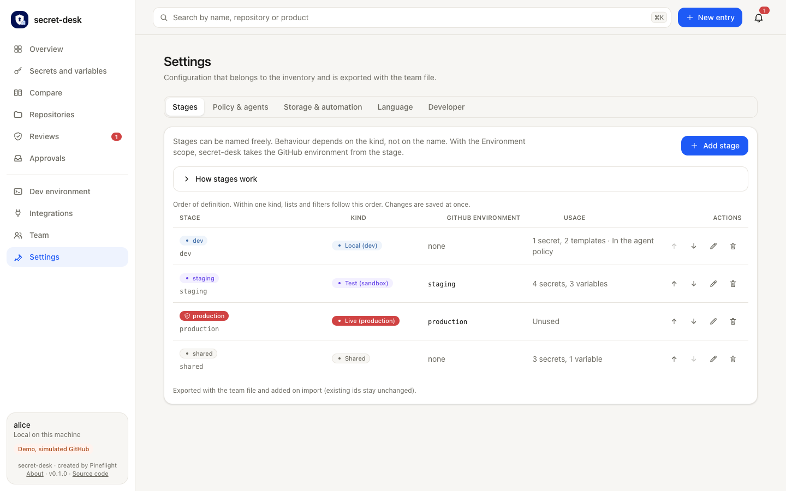](docs/images/settings.png)<br>**Settings:** freely configurable stages | [](docs/images/overview.png)<br>**Overview:** stat cards link to the filtered lists, the attention list comes first |

The same screens at phone width (375 px): [overview](docs/images/overview-375.png), [entries](docs/images/entries-375.png), [compare](docs/images/compare-375.png), [dev environment](docs/images/dev-env-375.png). A short tour of every screen: [docs/UI-GUIDE.md](docs/UI-GUIDE.md).

## Working .env.local in one command

New checkout, reset local stack, second repository that must share a token with the first: instead of copying keys out of
`supabase status`, generating webhook secrets by hand and pasting tokens between files, one command writes every file.

```bash
supabase start                      # or the repository's own start script
secret-desk env export --from-template --config ~/secret-desk.config.yaml --repo acme-web --repo acme-app
```

- **Right place:** each file lands in the linked checkout at the template's path (`<repo>/.env.local`), mode 600, with a
  warning when Git does not ignore it.
- **Local Supabase connected:** URL, anon/publishable and service role/secret keys come from the running local stack
  (`supabase status`, the repository's own CLI first). A stopped stack produces a clear message with the repository's start
  command, never placeholders.
- **Shared values:** a token the website sends and the API checks is generated once and written into both files.
- **Generated secrets:** random values with prefixes such as `whsec_`, Web Push VAPID pairs, UUIDs.
- **Optional inputs:** keys only you can provide (test keys of third parties) are asked for, or left as a commented line when
  optional, so the export never blocks.
- **No values anywhere else:** nothing is stored, logged or printed; the export never returns a value to an agent, and
  only dev stages are exported.

[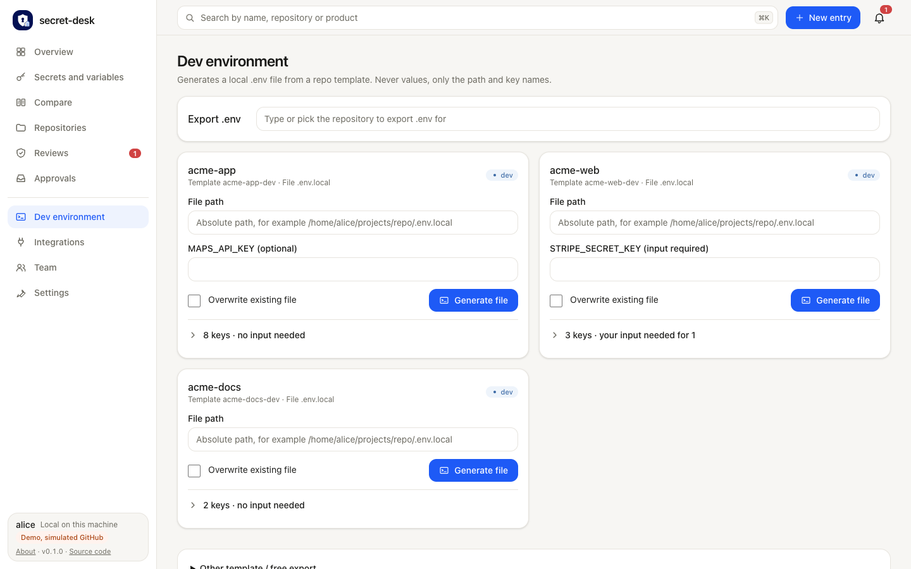](docs/images/dev-env.png)

The whole flow, the template format and what stays manual: [docs/DEV-ENV.md](docs/DEV-ENV.md).

## Architecture

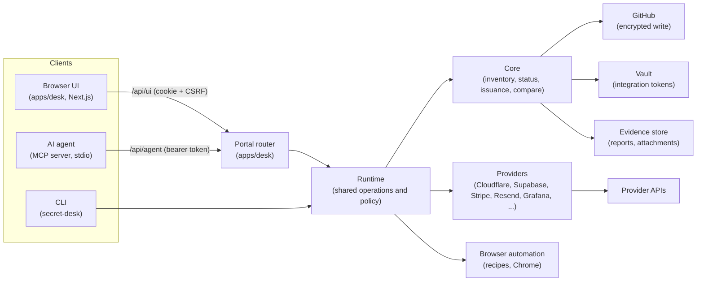

The portal listens on `127.0.0.1` only. The CLI, the portal and the MCP server share one runtime that enforces the policy (which stages an agent may touch, what only a human may do). Details: [docs/ARCHITECTURE.md](docs/ARCHITECTURE.md).

## Quick start

Requirements: **Node 24 or newer** and [pnpm](https://pnpm.io) 10. secret-desk is not published to npm; you run it from a checkout.

```bash
git clone https://github.com/Pineflight/secret-desk.git
cd secret-desk
pnpm install
pnpm build
```

**Demo without accounts** (simulated GitHub, made-up data, works on macOS, Linux and Windows):

```bash
pnpm demo
```

`pnpm demo` serves the portal at <http://127.0.0.1:4747>. It sets `SECRET_DESK_DEMO=1`, `SECRET_DESK_NO_LAUNCH_SECRET=1` and the demo configuration itself (see `scripts/demo.mjs`).

**Your own configuration:**

```bash
cp examples/secret-desk.config.example.yaml secret-desk.config.yaml
cp examples/inventory.example.yaml inventory.yaml
pnpm dev
```

On Windows use `Copy-Item` (PowerShell) or `copy` (cmd). Edit `github.owner` in `secret-desk.config.yaml`, then start the portal with `pnpm dev`.

**The launch secret.** Outside the demo, the portal prints a one-time address in the terminal where it runs, in the form `http://127.0.0.1:4747/?launch=<secret>`. Open exactly that address. The portal hands out a browser session only to someone who presents the secret, which keeps other local programs and web pages out. The page removes the secret from the address bar and never stores it. Details: [Security model](docs/SECURITY-MODEL.md#access-to-the-portal).

Provider and GitHub access tokens are entered per session in the portal, or the configuration points to environment variables or 1Password references (`op://...`). Never put a value in a file.

Next: the step-by-step [Getting started guide](docs/GETTING-STARTED.md) (GitHub token with the exact permissions, first renewal, dev `.env`).

Housekeeping: `pnpm clean` removes build output, `pnpm clean --deps` also `node_modules`. The CLI is `node packages/cli/dist/bin.js help`, see [docs/CLI.md](docs/CLI.md).

## Docker

The image is built for `linux/amd64` and `linux/arm64` and published at <https://github.com/Pineflight/secret-desk/pkgs/container/secret-desk>.

| Platform | Example devices | Tag |
| --- | --- | --- |
| `linux/arm64` | Raspberry Pi 4/5, Apple Silicon | `:latest-arm64` |
| `linux/amd64` | Intel/AMD PCs and servers | `:latest-amd64` |

`:latest` and `:<tag>` (for example `:v0.1.0-12`) pick the matching platform automatically. Use the single-platform tags only if you need a fixed assignment. The packages are public, so no `docker login` is needed.

Publish the port to the loopback address only:

```bash
docker pull ghcr.io/pineflight/secret-desk:latest
docker run --rm -p 127.0.0.1:4747:4747 -v secret-desk-data:/data ghcr.io/pineflight/secret-desk:latest
```

To reach the portal over a LAN address, publish the port on that address (`-p 192.168.1.20:4747:4747`) and set `SECRET_DESK_ALLOWED_HOSTS=192.168.1.20:4747`. The portal opens only with the launch address: start the container, read it with `docker logs <container>` (line `secret-desk: Portal oeffnen unter http://127.0.0.1:4747/?launch=...`) and replace host and port with your own. Compose file, vault key, automatic updates and a `.local` name without a port (reverse proxy): [docs/DOCKER.md](docs/DOCKER.md).

## Security principles

- Values are held in memory only, for at most 15 minutes, and passed on in exactly two places: the provider API and, encrypted, GitHub.
- The portal listens on `127.0.0.1` only and protects its API with a launch secret, a session cookie, a CSRF token, Host and Origin checks.
- Reports, logs, errors and responses never contain a value (only a short fingerprint).
- Agents get metadata, never values, and a human always confirms. Outside `policy.agentStages` (by default only stages of kind `dev`) an agent request needs an approval first.
- Integration tokens can be kept in an encrypted vault whose key lives in the OS keychain, never next to the data.

Details, limits and the threat model: [docs/SECURITY-MODEL.md](docs/SECURITY-MODEL.md). To report a vulnerability see [SECURITY.md](SECURITY.md).

## Platforms

secret-desk targets **macOS, Linux and Windows 10/11** (portal, CLI, MCP server, browser automation). Development and real-world testing so far happen on macOS. Linux and Windows behavior is covered through simulated platforms (injected `platform` and commands, `path.win32`). The manually triggered [`Cross-Platform` workflow](.github/workflows/cross-platform.yml) runs install, build, typecheck and tests on real Linux, macOS and Windows runners.

| | macOS | Linux | Windows 10/11 |
|---|---|---|---|
| Requirements | Node 24, pnpm | Node 24, pnpm | Node 24, pnpm (PowerShell 5.1 or newer is included) |
| Vault key | Keychain (`security`) | `secret-tool` (libsecret, for example GNOME Keyring or KWallet); otherwise `SECRET_DESK_VAULT_KEY` or `vault.keyFile` | DPAPI (bound to the Windows account), blob in `<vault>.key` |
| Browser automation | Chrome, Chromium, Edge | Chrome, Chromium or Edge as a distribution package; Snap and Flatpak are sandboxed and often do not work | Chrome or Edge (Program Files, Program Files (x86), `%LOCALAPPDATA%`) |
| File permissions | chmod 600/700 | chmod 600/700 | no POSIX modes: protection through the user profile (ACL) |

Known limits:

- **Windows:** network paths (`\\server\share`), `\\?\` paths and reserved names (`CON`, `NUL`, `COM1` ...) are rejected. Folder links require a local drive path below the user folder or `policy.envRoots`. The vault key cannot be moved to another machine or account (by design); enter a new token there.
- **Linux without a keyring** (servers, containers, WSL without D-Bus): the vault reports this clearly and stores nothing in plain text. Set `SECRET_DESK_VAULT_KEY` (`openssl rand -base64 32`) or point `vault.keyFile` to a key file with mode 600. With `vault.keyFile`, key and data sit on the same disk; this only protects the file system.
- **WSL** counts as Linux: home folder, keyring and Chrome are those of the Linux side, not of Windows.
- YAML paths may use `~` (and `~\` on Windows). Put paths with backslashes in single quotes (`'C:\path\to\projects'`) or use forward slashes.
- `.gitattributes` enforces LF line endings; on Windows no `core.autocrlf` is needed.

## Documentation

| Document | Contents |
|---|---|
| [UI guide](docs/UI-GUIDE.md) | A short tour of every screen: what you do there, where the main action is |
| [Getting started](docs/GETTING-STARTED.md) | Demo, your own configuration, inventory, GitHub token, first renewal, dev `.env` |
| [Configuration](docs/CONFIGURATION.md) | Every field of `secret-desk.config.yaml` and `inventory.yaml` |
| [CLI](docs/CLI.md) | All commands and options |
| [Agents (MCP and skill)](docs/AGENTS.md) | The 24 MCP tools, skill installation, policy for AI agents |
| [Agent API](docs/AGENT-API.md) | HTTP reference of `/api/agent` ([OpenAPI](docs/openapi-agent.yaml)) |
| [Integration API](docs/INTEGRATION-API.md) | Stable contract for other systems (issue trackers, wikis, CI), webhooks plan, Jira, Confluence and Azure DevOps examples ([OpenAPI](docs/api/openapi.yaml)) |
| [Stages](docs/STAGES.md) | Stage kinds, environment derivation, custom stages, team export |
| [Compare](docs/COMPARE.md) | Cell states, parity, orphans, workflow needs, live reading, the toolbar |
| [Repositories](docs/REPOSITORIES.md) | Selection, local links, path rules, search, renames |
| [Integrations](docs/INTEGRATIONS.md) | Permissions per integration, test connection, write test, vault |
| [Providers](docs/PROVIDERS.md) | Supported providers, parameters, how well each endpoint is verified |
| [Developing integrations](docs/DEVELOPING-INTEGRATIONS.md) | Adding a provider step by step: parts, exploring a page, dry run, tests, checklist |
| [Browser recipes](docs/RECIPES.md) | Writing recipes; [Browser automation](docs/BROWSER-AUTOMATION.md) explains the design |
| [Docker](docs/DOCKER.md) | Container on a Raspberry Pi in the LAN: compose file, allowed hosts, vault key, automatic updates |
| [Search](docs/SEARCH.md) | Command palette (⌘K / Ctrl K), tolerant search, filter syntax, history |
| [Team](docs/TEAM.md) | Sharing the configuration, onboarding |
| [Architecture](docs/ARCHITECTURE.md) | Path of a value, data, packages |
| [Security model](docs/SECURITY-MODEL.md) | What is protected and how, limits |
| [Trial run](docs/TRIAL-RUN.md) | A guided first run with real services in a throwaway repository |
| [Troubleshooting](docs/TROUBLESHOOTING.md) | Common errors and fixes |
| [FAQ](docs/FAQ.md) | Frequently asked questions |

## Project status

Early version (0.1.0), not yet used in production at scale. Honest limits:

- **Several provider endpoints are only tested against mocks.** They were implemented from documentation and not verified against the live services ([docs/PROVIDERS.md](docs/PROVIDERS.md) lists, per provider, how certain each endpoint is). Try each provider with a throwaway token before real use.
- **The browser recipes have not been checked against the live provider pages** ([docs/BROWSER-AUTOMATION.md](docs/BROWSER-AUTOMATION.md)). Every bundled recipe carries a `# STATUS` comment saying so.
- **Real-world testing so far happened on macOS.** Windows and Linux are covered by simulated platforms and the manually triggered cross-platform workflow.
- The GitHub side (encrypting and writing secrets and variables, environments) was exercised against the real GitHub in a throwaway repository on 27 October 2026 ([docs/TRIAL-RUN.md](docs/TRIAL-RUN.md)).
- A first full rollout over a dozen repositories ran on 2 November 2026 from a Raspberry Pi ([docs/FULL-SYNC.md](docs/FULL-SYNC.md)): about 50 secrets created at Cloudflare, Supabase, Stripe (sandbox), Resend and locally, and over 50 variables written. It found and fixed one provider bug (Supabase key names).

## Roadmap ideas

In progress: live verification of the RevenueCat sign-in beyond the email step. Planned: facades (guided sign-in) for more providers, Peecho, VesselAPI and OpenAI recipes, Cloudflare R2 credentials and Access service tokens, GitHub App tokens instead of personal tokens, VAPID pairs, organization secrets. The full list with the external services secret-desk talks to: [Providers and roadmap](docs/ROADMAP.md). Ideas, not promises.

- An OpenAPI description for the human routes (`/api/ui`) in addition to the [agent routes](docs/openapi-agent.yaml).

## Contributing

Contributions are welcome. Read [CONTRIBUTING.md](CONTRIBUTING.md) first: setup, `pnpm verify`, test rules, code style. Browser recipes are YAML files under `recipes/` and can be contributed as pull requests ([docs/RECIPES.md](docs/RECIPES.md)). By participating you agree to the [Code of Conduct](CODE_OF_CONDUCT.md). Questions: [SUPPORT.md](SUPPORT.md). Security issues: [SECURITY.md](SECURITY.md). Release notes: [CHANGELOG.md](CHANGELOG.md).

## License and credits

secret-desk is created by [Pineflight](https://github.com/Pineflight) and released under the [MIT license](LICENSE) (copyright line unchanged: Niklas Lurse (Pineflight)). The portal shows this on its **About** page (`/about`) and in the sidebar footer, and the CLI prints it with `secret-desk about` (`--version` prints the version only). The Docker image carries the same information as OCI labels (vendor, authors, source, license, version, revision) and contains `LICENSE` and `THIRD-PARTY-NOTICES.md` under `/licenses`.

**Third-party licenses.** The browser sidecar image bundles Chromium, Xvfb, x11vnc, noVNC, websockify and socat from Debian; [docker/browser/THIRD-PARTY-NOTICES.md](docker/browser/THIRD-PARTY-NOTICES.md) lists them with licenses and where to get their source. [THIRD-PARTY-NOTICES.md](THIRD-PARTY-NOTICES.md) lists every production dependency with version and license. It is generated offline by `node scripts/licenses.mjs` from the installed dependencies, and CI runs `node scripts/licenses.mjs --check`, which fails on a forbidden (GPL, AGPL, SSPL ...) or unknown license and on a stale list, and warns about everything outside the allow list (MIT, ISC, BSD-2/3-Clause, Apache-2.0, 0BSD, BlueOak-1.0.0, CC0-1.0, Python-2.0, Unlicense; MPL-2.0 only as a warning).

**Privacy.** No telemetry, no connection to Pineflight servers. secret-desk only talks to the providers and GitHub that you configure (and optionally the repository of your team sync). This is checked in the source by a test (`packages/runtime/test/about.test.ts`: no telemetry library, no Pineflight host in the code). The Next.js framework has its own optional telemetry; it is switched off in the Docker image and in `pnpm demo`; for `pnpm dev` and `pnpm start` set `NEXT_TELEMETRY_DISABLED=1`.

## License

[MIT](LICENSE). Copyright (c) Niklas Lurse (Pineflight).
