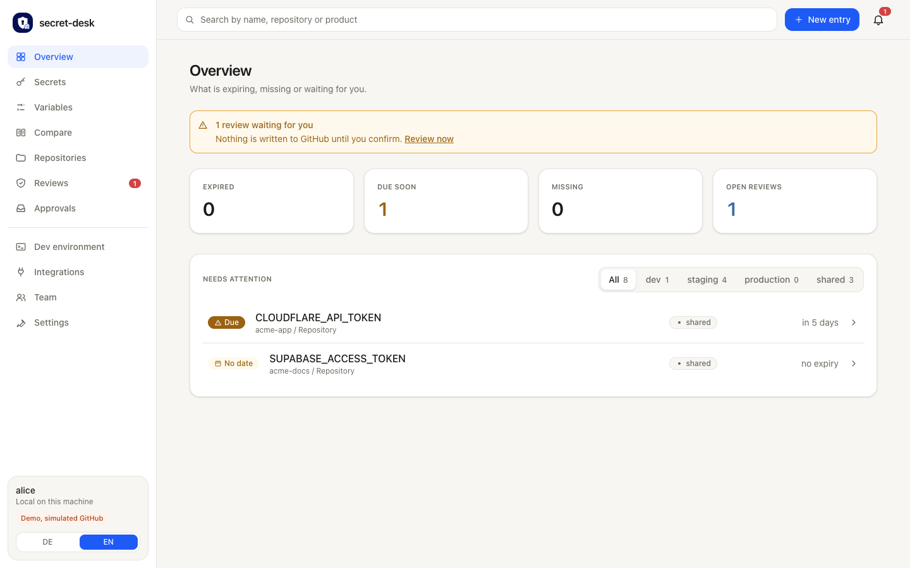
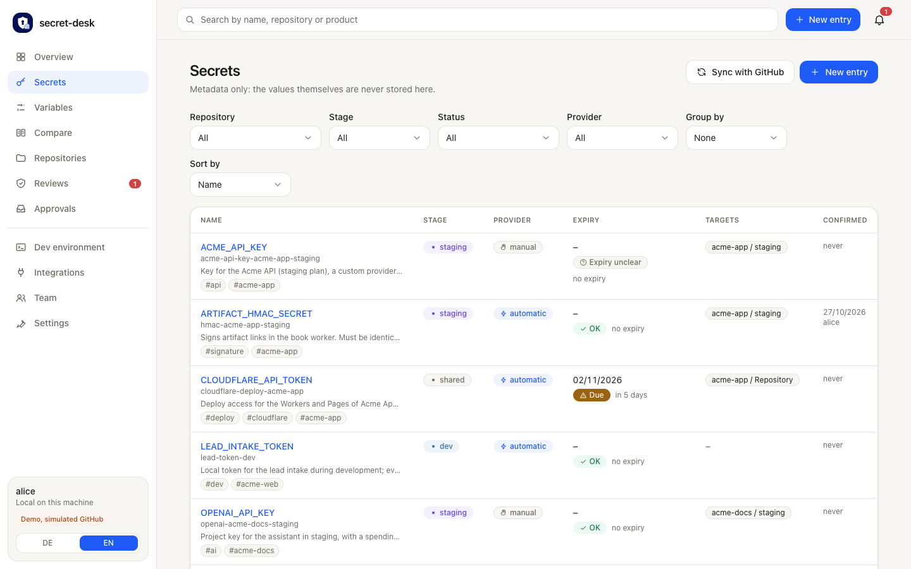
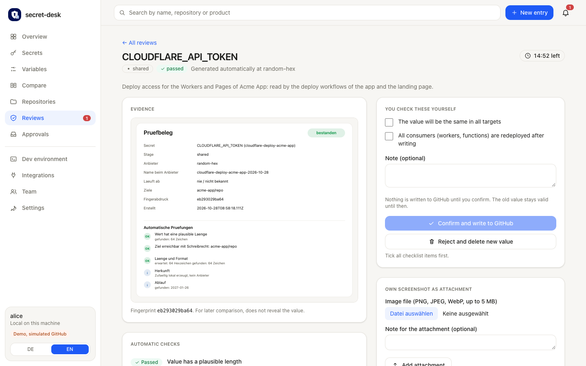
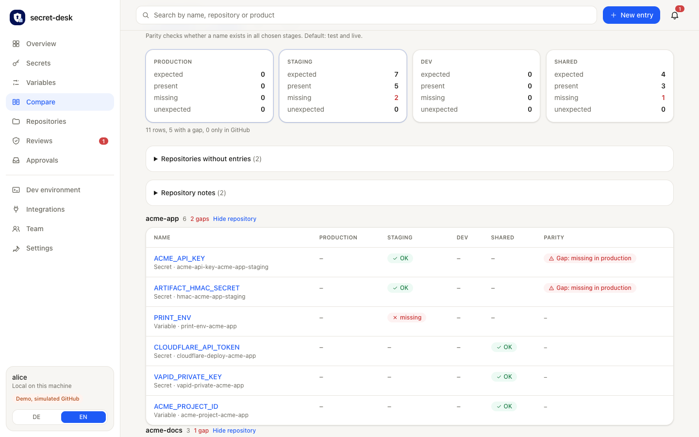
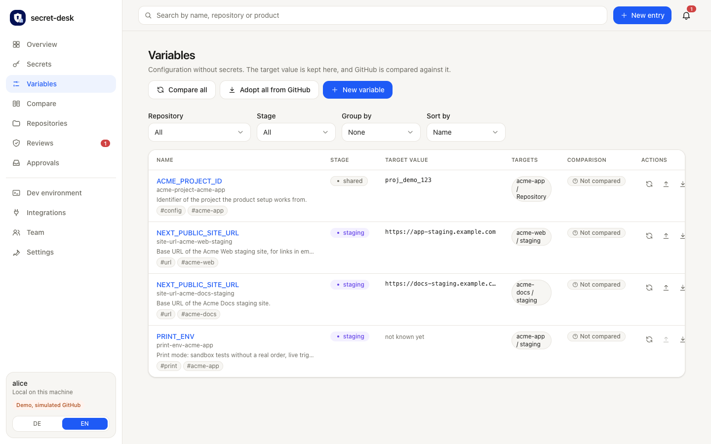
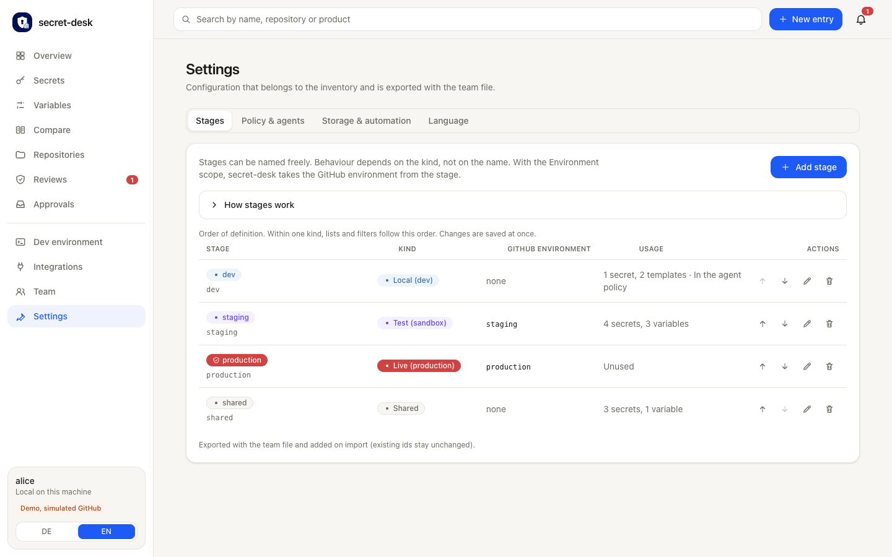
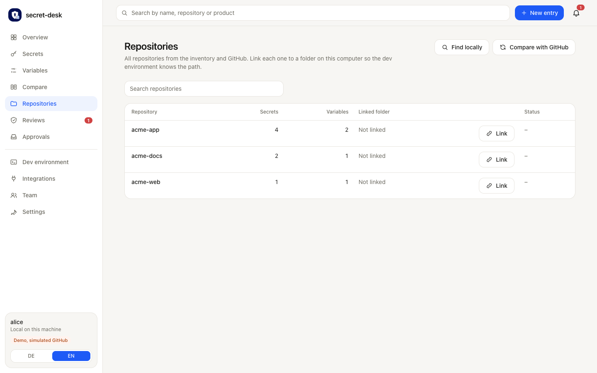
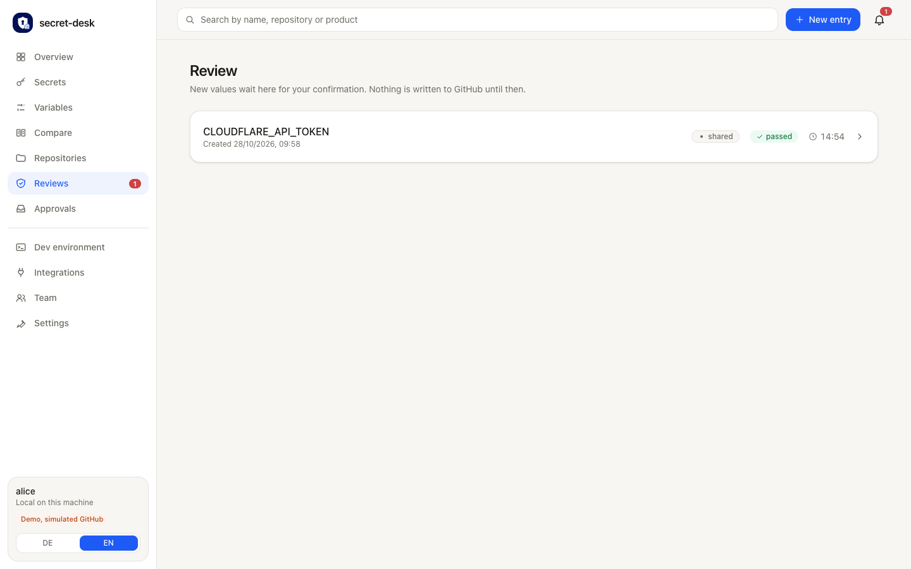
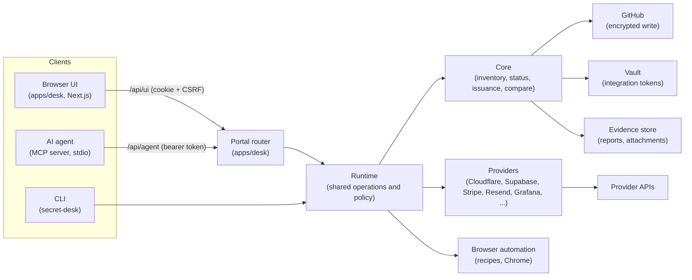

<p align="center"></p>

<h1 align="center">secret-desk</h1>

<p align="center">
A local-first portal that shows what expires when, issues new tokens at the providers, lets a human review and confirm each new value, and only then writes it straight into GitHub. Secret values are never stored.
</p>

<p align="center">
  <a href="https://github.com/Pineflight/secret-desk/actions/workflows/ci.yml"></a>
  <a href="LICENSE"></a>
  = 24">
</p>

<p align="center"></p>

## Contents

- [Why secret-desk](#why-secret-desk)
- [Features](#features)
- [Screenshots](#screenshots)
- [Architecture](#architecture)
- [Quick start](#quick-start)
- [Docker](#docker)
- [Security principles](#security-principles)
- [Platforms](#platforms)
- [Documentation](#documentation)
- [Project status](#project-status)
- [Roadmap ideas](#roadmap-ideas)
- [Contributing](#contributing)
- [License](#license)

## Why secret-desk

Teams that deploy through GitHub Actions end up with tokens, API keys and webhook secrets spread over many repositories and environments. Three things go wrong again and again:

- **Nobody knows what expires when.** A Cloudflare token runs out on a Friday evening and the deploy workflow turns red.
- **Creating the new value is manual and error-prone.** Someone opens the provider dashboard, clicks through a form, copies the value, and pastes it into several places, sometimes the wrong stage.
- **Nobody checks the new value before it goes live.** And the old one is forgotten at the provider.

secret-desk closes these gaps without becoming a second secret store:

- **Expiry overview.** Every secret and variable is listed by stage and status, with owner, description and links.
- **Provider issuance through APIs.** Where a provider has an API, the portal generates the new value for you.
- **Review and confirm before GitHub.** The new value is verified (function test, permissions, expiry, targets reachable) and summarized in a review report with an evidence image. A human ticks the review items. Only then is the value written to GitHub and the old one revoked. Rejecting deletes the new value at the provider again.
- **Values are never stored.** They live in memory for at most 15 minutes and are passed on in exactly two places: the provider API and, encrypted, GitHub.

## Features

- **Expiry overview:** secrets listed by stage and status (ok, soon, due, expired, missing), with description, owner, link and tags. A daily workflow can raise expiry reminders as GitHub issues (`secret-desk check`, [examples/workflows](examples/workflows/secret-desk-expiry.yml)).
- **Two-stage issuance with review evidence:** generate at the provider, verify, review report plus evidence image, human confirmation (optionally with your own screenshot), then write. Providers without an API use the same flow with a manual paste. See [Architecture](docs/ARCHITECTURE.md#the-path-of-a-new-value).
- **Configurable stages:** define your own stages (default `dev`, `staging`, `production`, `shared`). Behavior follows the stage `kind`, not its name. See [Stages](docs/STAGES.md).
- **Variables (`vars.*`):** configuration values with an expected value that is compared with GitHub and applied on request. A guard stops secrets from ending up as variables.
- **Compare across stages and all repositories:** one matrix of secrets and variables against stages, with live read-only checks against GitHub, repositories without inventory entries, what workflows need (`secrets.*`/`vars.*`), orphans and renamed repositories. See [Compare](docs/COMPARE.md).
- **Repositories and local links:** link repositories to folders on your machine (links never leave it). See [Repositories](docs/REPOSITORIES.md).
- **Parameters and resource selection:** each provider declares what an entry needs (account, project, zone, domain). The portal lists the resources of the connected integration read-only, suggests at most one match that you confirm with a click, blocks issuing while required parameters are missing and runs a read-only preflight. Variables can load public values (project URL, zone id, sitekey) from a provider. See [Parameters and resources](docs/RESOURCES.md).
- **Integrations with permission guides:** for each provider the exact permissions to grant, a link that prefills the GitHub token form, a read-only **Test connection** and an opt-in **write test**. See [Integrations](docs/INTEGRATIONS.md).
- **Encrypted vault for integration tokens:** optional, AES-256-GCM, key in the OS keychain (macOS Keychain, Linux `secret-tool`, Windows DPAPI) or a key file.
- **Browser automation recipes:** for providers without an API, a visible Chrome walks through the form from a YAML recipe. Sign-in, 2FA and CAPTCHA stay with the human. See [Recipes](docs/RECIPES.md).
- **Dev `.env` export:** per-repository templates produce the file on demand (defaults, random values, personal dev tokens, variables) with mode 600, stored nowhere.
- **Team file:** export the configuration without values so new team members import it and start. See [Team](docs/TEAM.md).
- **MCP server, skill and agent HTTP API:** AI agents maintain metadata, query status and request renewals. They never see values and never confirm. See [Agents](docs/AGENTS.md) and the [Agent API](docs/AGENT-API.md).
- **German and English UI**, runs on **macOS, Linux and Windows**.

## Screenshots

All screenshots come from the built-in demo (simulated GitHub, made-up data) and are produced by `pnpm docs:screenshots`.

| | |
|---|---|
| [](docs/images/secrets.png)<br>**Secrets:** status, stage, provider, expiry and targets at a glance | [](docs/images/review-detail.png)<br>**Review:** evidence image, checklist, confirm or reject |
| [](docs/images/compare-live.png)<br>**Compare:** live matrix of names against stages | [](docs/images/variables.png)<br>**Variables:** expected value against GitHub |
| [](docs/images/integrations.png)<br>**Integrations:** connection state, guides, test connection | [](docs/images/settings.png)<br>**Settings:** freely configurable stages |
| [](docs/images/repositories.png)<br>**Repositories:** link folders on this machine | [](docs/images/reviews.png)<br>**Reviews:** open reviews waiting for a human |

## Architecture



The portal listens on `127.0.0.1` only. The CLI, the portal and the MCP server share one runtime that enforces the policy (which stages an agent may touch, what only a human may do). Details: [docs/ARCHITECTURE.md](docs/ARCHITECTURE.md).

## Quick start

Requirements: **Node 24 or newer** and [pnpm](https://pnpm.io) 10. secret-desk is not published to npm; you run it from a checkout.

```bash
git clone https://github.com/Pineflight/secret-desk.git
cd secret-desk
pnpm install
pnpm build
```

**Demo without accounts** (simulated GitHub, made-up data, works on macOS, Linux and Windows):

```bash
pnpm demo
```

`pnpm demo` serves the portal at <http://127.0.0.1:4747>. It sets `SECRET_DESK_DEMO=1`, `SECRET_DESK_NO_LAUNCH_SECRET=1` and the demo configuration itself (see `scripts/demo.mjs`).

**Your own configuration:**

```bash
cp examples/secret-desk.config.example.yaml secret-desk.config.yaml
cp examples/inventory.example.yaml inventory.yaml
pnpm dev
```

On Windows use `Copy-Item` (PowerShell) or `copy` (cmd). Edit `github.owner` in `secret-desk.config.yaml`, then start the portal with `pnpm dev`.

**The launch secret.** Outside the demo, the portal prints a one-time address in the terminal where it runs, in the form `http://127.0.0.1:4747/?launch=<secret>`. Open exactly that address. The portal hands out a browser session only to someone who presents the secret, which keeps other local programs and web pages out. The page removes the secret from the address bar and never stores it. Details: [Security model](docs/SECURITY-MODEL.md#access-to-the-portal).

Provider and GitHub access tokens are entered per session in the portal, or the configuration points to environment variables or 1Password references (`op://...`). Never put a value in a file.

Next: the step-by-step [Getting started guide](docs/GETTING-STARTED.md) (GitHub token with the exact permissions, first renewal, dev `.env`).

Housekeeping: `pnpm clean` removes build output, `pnpm clean --deps` also `node_modules`. The CLI is `node packages/cli/dist/bin.js help`, see [docs/CLI.md](docs/CLI.md).

## Docker

The image is built for `linux/amd64` and `linux/arm64` and published at <https://github.com/Pineflight/secret-desk/pkgs/container/secret-desk>.

| Platform | Example devices | Tag |
| --- | --- | --- |
| `linux/arm64` | Raspberry Pi 4/5, Apple Silicon | `:latest-arm64` |
| `linux/amd64` | Intel/AMD PCs and servers | `:latest-amd64` |

`:latest` and `:<tag>` (for example `:v0.1.0-12`) pick the matching platform automatically. Use the single-platform tags only if you need a fixed assignment. The packages are public, so no `docker login` is needed.

Publish the port to the loopback address only:

```bash
docker pull ghcr.io/pineflight/secret-desk:latest
docker run --rm -p 127.0.0.1:4747:4747 -v secret-desk-data:/data ghcr.io/pineflight/secret-desk:latest
```

To reach the portal over a LAN address, publish the port on that address (`-p 192.168.1.20:4747:4747`) and set `SECRET_DESK_ALLOWED_HOSTS=192.168.1.20:4747`. The launch address is in the container log (`docker logs`). Compose file, vault key and automatic updates: [docs/DOCKER.md](docs/DOCKER.md).

## Security principles

- Values are held in memory only, for at most 15 minutes, and passed on in exactly two places: the provider API and, encrypted, GitHub.
- The portal listens on `127.0.0.1` only and protects its API with a launch secret, a session cookie, a CSRF token, Host and Origin checks.
- Reports, logs, errors and responses never contain a value (only a short fingerprint).
- Agents get metadata, never values, and a human always confirms. Outside `policy.agentStages` (by default only stages of kind `dev`) an agent request needs an approval first.
- Integration tokens can be kept in an encrypted vault whose key lives in the OS keychain, never next to the data.

Details, limits and the threat model: [docs/SECURITY-MODEL.md](docs/SECURITY-MODEL.md). To report a vulnerability see [SECURITY.md](SECURITY.md).

## Platforms

secret-desk targets **macOS, Linux and Windows 10/11** (portal, CLI, MCP server, browser automation). Development and real-world testing so far happen on macOS. Linux and Windows behavior is covered through simulated platforms (injected `platform` and commands, `path.win32`). The manually triggered [`Cross-Platform` workflow](.github/workflows/cross-platform.yml) runs install, build, typecheck and tests on real Linux, macOS and Windows runners.

| | macOS | Linux | Windows 10/11 |
|---|---|---|---|
| Requirements | Node 24, pnpm | Node 24, pnpm | Node 24, pnpm (PowerShell 5.1 or newer is included) |
| Vault key | Keychain (`security`) | `secret-tool` (libsecret, for example GNOME Keyring or KWallet); otherwise `SECRET_DESK_VAULT_KEY` or `vault.keyFile` | DPAPI (bound to the Windows account), blob in `<vault>.key` |
| Browser automation | Chrome, Chromium, Edge | Chrome, Chromium or Edge as a distribution package; Snap and Flatpak are sandboxed and often do not work | Chrome or Edge (Program Files, Program Files (x86), `%LOCALAPPDATA%`) |
| File permissions | chmod 600/700 | chmod 600/700 | no POSIX modes: protection through the user profile (ACL) |

Known limits:

- **Windows:** network paths (`\\server\share`), `\\?\` paths and reserved names (`CON`, `NUL`, `COM1` ...) are rejected. Folder links require a local drive path below the user folder or `policy.envRoots`. The vault key cannot be moved to another machine or account (by design); enter a new token there.
- **Linux without a keyring** (servers, containers, WSL without D-Bus): the vault reports this clearly and stores nothing in plain text. Set `SECRET_DESK_VAULT_KEY` (`openssl rand -base64 32`) or point `vault.keyFile` to a key file with mode 600. With `vault.keyFile`, key and data sit on the same disk; this only protects the file system.
- **WSL** counts as Linux: home folder, keyring and Chrome are those of the Linux side, not of Windows.
- YAML paths may use `~` (and `~\` on Windows). Put paths with backslashes in single quotes (`'C:\path\to\projects'`) or use forward slashes.
- `.gitattributes` enforces LF line endings; on Windows no `core.autocrlf` is needed.

## Documentation

| Document | Contents |
|---|---|
| [Getting started](docs/GETTING-STARTED.md) | Demo, your own configuration, inventory, GitHub token, first renewal, dev `.env` |
| [Configuration](docs/CONFIGURATION.md) | Every field of `secret-desk.config.yaml` and `inventory.yaml` |
| [CLI](docs/CLI.md) | All commands and options |
| [Agents (MCP and skill)](docs/AGENTS.md) | The 24 MCP tools, skill installation, policy for AI agents |
| [Agent API](docs/AGENT-API.md) | HTTP reference of `/api/agent` ([OpenAPI](docs/openapi-agent.yaml)) |
| [Stages](docs/STAGES.md) | Stage kinds, environment derivation, custom stages, team export |
| [Compare](docs/COMPARE.md) | Cell states, parity, orphans, workflow needs, live reading |
| [Repositories](docs/REPOSITORIES.md) | Selection, local links, path rules, search, renames |
| [Integrations](docs/INTEGRATIONS.md) | Permissions per integration, test connection, write test, vault |
| [Providers](docs/PROVIDERS.md) | Supported providers, parameters, how well each endpoint is verified |
| [Browser recipes](docs/RECIPES.md) | Writing recipes; [Browser automation](docs/BROWSER-AUTOMATION.md) explains the design |
| [Docker](docs/DOCKER.md) | Container on a Raspberry Pi in the LAN: compose file, allowed hosts, vault key, automatic updates |
| [Team](docs/TEAM.md) | Sharing the configuration, onboarding |
| [Architecture](docs/ARCHITECTURE.md) | Path of a value, data, packages |
| [Security model](docs/SECURITY-MODEL.md) | What is protected and how, limits |
| [Trial run](docs/TRIAL-RUN.md) | A guided first run with real services in a throwaway repository |
| [Troubleshooting](docs/TROUBLESHOOTING.md) | Common errors and fixes |
| [FAQ](docs/FAQ.md) | Frequently asked questions |

## Project status

Early version (0.1.0), not yet used in production at scale. Honest limits:

- **Several provider endpoints are only tested against mocks.** They were implemented from documentation and not verified against the live services ([docs/PROVIDERS.md](docs/PROVIDERS.md) lists, per provider, how certain each endpoint is). Try each provider with a throwaway token before real use.
- **The browser recipes have not been checked against the live provider pages** ([docs/BROWSER-AUTOMATION.md](docs/BROWSER-AUTOMATION.md)). Every bundled recipe carries a `# STATUS` comment saying so.
- **Real-world testing so far happened on macOS.** Windows and Linux are covered by simulated platforms and the manually triggered cross-platform workflow.
- The GitHub side (encrypting and writing secrets and variables, environments) was exercised against the real GitHub in a throwaway repository on 27 October 2026 ([docs/TRIAL-RUN.md](docs/TRIAL-RUN.md)).

## Roadmap ideas

Ideas, not promises:

- An OpenAPI description for the human routes (`/api/ui`) in addition to the [agent routes](docs/openapi-agent.yaml).
- More providers, and verifying the existing endpoints against the live services.
- Organization-level secrets in the portal (the `organization` scope exists in the schema, but the portal form does not offer it yet).
- Verified browser recipes, and recipe-driven revocation.

## Contributing

Contributions are welcome. Read [CONTRIBUTING.md](CONTRIBUTING.md) first: setup, `pnpm verify`, test rules, code style. Browser recipes are YAML files under `recipes/` and can be contributed as pull requests ([docs/RECIPES.md](docs/RECIPES.md)). By participating you agree to the [Code of Conduct](CODE_OF_CONDUCT.md). Questions: [SUPPORT.md](SUPPORT.md). Security issues: [SECURITY.md](SECURITY.md). Release notes: [CHANGELOG.md](CHANGELOG.md).

## License

[MIT](LICENSE). Copyright (c) Niklas Lurse (Pineflight).
