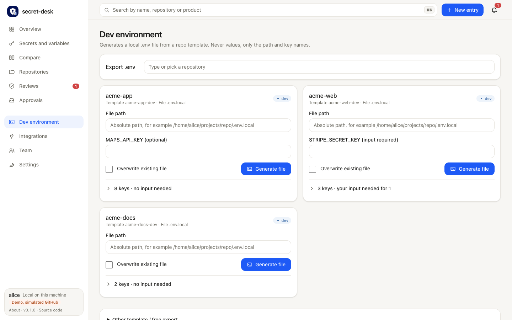

# Local development: a working `.env.local` per repository

This guide is for developers. It shows how a dev template in the inventory turns into a working `.env.local` in each
repository checkout, which values secret-desk produces, how the local Supabase stack is connected, and what stays manual.



Rules that hold throughout:

- Only stages of kind `dev` go into these files. Staging and production secrets, and live keys, never end up in a dev file.
- Values come into existence during the export and are stored nowhere else: not in the inventory, not in a log, not on the
  terminal. The file is written with mode 600.
- The file must be ignored by Git. The export warns when it is not.

## Contents

- [1. Where it runs: your machine](#1-where-it-runs-your-machine)
- [2. One-time setup](#2-one-time-setup)
- [3. Template sources](#3-template-sources)
- [4. Local Supabase](#4-local-supabase)
- [5. Optional values](#5-optional-values)
- [6. Shared values between repositories](#6-shared-values-between-repositories)
- [7. Daily use](#7-daily-use)
- [8. Portal and agents](#8-portal-and-agents)
- [9. Troubleshooting](#9-troubleshooting)
- [10. What stays manual](#10-what-stays-manual)

## 1. Where it runs: your machine

The portal often runs on a small always-on server that owns the GitHub secrets and the inventory. The dev export belongs on
the developer machine (for example a Mac), because that is where the checkouts, the local Docker stack and the `.env.local`
files are:

- The **CLI** on your machine reads the same inventory (a local copy, the team file, or the server's inventory through your
  configuration) and writes into your checkouts.
- Only the CLI on your machine runs local commands such as `supabase status`. The server never runs them, and never sees the
  local keys.
- Repository links (which repository is which folder) live on your machine only, in `~/.secret-desk/repo-links.json`.

## 2. One-time setup

1. Build the CLI: `pnpm install && pnpm build` in the secret-desk checkout. The binary is `packages/cli/dist/bin.js`,
   called `secret-desk` below (an alias such as `alias secret-desk="node ~/src/secret-desk/packages/cli/dist/bin.js"` helps).
2. Point a `secret-desk.config.yaml` at the inventory ([CONFIGURATION.md](CONFIGURATION.md)). In a team, import the team
   file first ([TEAM.md](TEAM.md)).
3. Link each repository to its checkout, in the portal (Repositories) or with the scan there
   ([REPOSITORIES.md](REPOSITORIES.md)). The export writes to `<linked folder>/<template file>`.
4. Make sure each repository ignores its env file (`.env.local` or the template's `file`).
5. For repositories with a local Supabase stack: Docker running and the Supabase CLI available, either as a dev dependency
   of the repository (`node_modules/.bin/supabase`) or on `PATH`.

## 3. Template sources

Each entry of a template names its source (`from.type`). Field reference: [CONFIGURATION.md](CONFIGURATION.md#env-templates).

| Source | Produced by | Typical keys |
|---|---|---|
| `default` | the template (non-secret values only) | `NEXT_PUBLIC_SITE_URL=http://localhost:3000` |
| `variable` | the expected value of an inventory variable | public URLs, project ids |
| `generate` | a fresh random value (`hex`, `base64`, `base64url`, `uuid`), optionally with a `prefix` | `RATE_LIMIT_SECRET`, `CRON_SECRET`, `STRIPE_WEBHOOK_SECRET` with `prefix: whsec_` |
| `generate` with `kind: vapid-public` / `vapid-private` | one Web Push key pair per export (`pair` groups them) | `VAPID_PUBLIC_KEY`, `VAPID_PRIVATE_KEY` |
| `command` (`supabase-status`) | the running local Supabase stack | `SUPABASE_URL`, anon/publishable key, service role/secret key |
| `ref` | the value another template's key has | a token the API checks and the website sends |
| `issue` | a personal dev token at the provider (automatic providers only) | a scoped dev API token |
| `prompt` | you, at export time; `optional: true` leaves it empty instead of blocking | third-party test keys you hold yourself |

A complete example for two repositories:

```yaml
envTemplates:
  - id: acme-web-dev
    repo: acme-web
    stage: dev
    entries:
      - { key: NEXT_PUBLIC_SITE_URL, from: { type: default, value: "http://localhost:3000" } }
      - { key: LEAD_INTAKE_TOKEN, from: { type: generate, kind: hex, bytes: 32 } }
  - id: acme-app-dev
    repo: acme-app
    stage: dev
    file: .env.local
    entries:
      - { key: SUPABASE_URL, from: { type: command, command: supabase-status, key: API_URL } }
      - { key: SUPABASE_ANON_KEY, from: { type: command, command: supabase-status, key: ANON_KEY } }
      - { key: SUPABASE_SERVICE_ROLE_KEY, from: { type: command, command: supabase-status, key: SERVICE_ROLE_KEY } }
      - { key: LEAD_INTAKE_TOKENS, from: { type: ref, template: acme-web-dev, key: LEAD_INTAKE_TOKEN } }
      - { key: STRIPE_WEBHOOK_SECRET, from: { type: generate, kind: base64, bytes: 24, prefix: whsec_ } }
      - { key: VAPID_PUBLIC_KEY, from: { type: generate, kind: vapid-public } }
      - { key: VAPID_PRIVATE_KEY, from: { type: generate, kind: vapid-private } }
      - { key: MAPS_API_KEY, description: Only for the map view, from: { type: prompt, optional: true, hint: test key from the maps console } }
```

## 4. Local Supabase

A `command` entry with `command: supabase-status` connects the file to the local stack of that repository:

- The CLI runs `supabase status -o env` in the linked checkout. It prefers the repository's own Supabase CLI
  (`node_modules/.bin/supabase`) and falls back to `supabase` on `PATH`. Program and arguments are fixed in secret-desk;
  a template can only pick the key. There is no shell, the timeout is 30 seconds, and the command sees only basic
  environment variables (`PATH`, `HOME`, Docker settings), never prompt values or tokens.
- `key` is a name from that output. Depending on the Supabase CLI version these include `API_URL`, `DB_URL`, `ANON_KEY`,
  `SERVICE_ROLE_KEY`, `PUBLISHABLE_KEY` and `SECRET_KEY`. Run `supabase status -o env` once yourself to see which names your
  version prints (the output contains keys: do not paste it anywhere).
- The command runs once per export, however many entries use it.
- When the stack is not running, the export stops before anything is written and says how to start it, taken from the
  repository: its own `package.json` script that runs `supabase start` (for example `pnpm run db:start`), otherwise
  `pnpm exec supabase start` (or the yarn/npm equivalent) when the repository has the CLI, otherwise `supabase start`.
  The message names the command and exit code only, never output.
- A key the command does not report fails the export, unless the entry has `optional: true`.
- After `supabase stop` / `supabase db reset` the local keys usually stay the same; after a new project setup they change.
  Export again with `--overwrite` then.

## 5. Optional values

- `prompt` entries ask you for a value: `--prompt KEY=VALUE` or the environment variable `SECRET_DESK_PROMPT_<KEY>` in the CLI,
  a password field in the portal.
- A required `prompt` without a value stops the export (exit `1`) and lists the keys.
- With `optional: true` the export goes on and writes `# KEY= (optional: <hint>)`. Fill the line in by hand later, or export
  again with the value.
- `command` entries can be optional too: a key the local command does not report is then left as a commented line.
- The CLI lists every key it left empty (`left empty: ...`); the portal shows them under the result.

## 6. Shared values between repositories

Some values must be equal in two repositories, for example a token one app sends and another checks. Generate it in one
template and point the other at it with `ref`:

```yaml
- { key: LEAD_INTAKE_TOKENS, from: { type: ref, template: acme-web-dev, key: LEAD_INTAKE_TOKEN } }
```

- In one run (`--repo` given more than once) the CLI exports the referenced template first and passes its value along in
  memory.
- Exporting the referring repository alone reads the value from the file the other template produced earlier, in that
  repository's linked folder. The file must be a regular file inside the folder (symlinks out of it are not followed).
- If the referenced template was exported in the same run but left the key empty, the old file is not used: the export
  stops instead of mixing old and new values.
- The value is stored nowhere else. Regenerating a shared value means exporting both repositories together with
  `--overwrite`, otherwise the files disagree.
- A `ref` must point to a template of the same stage, must not point to its own template and must not point to another
  `ref`. A list key that accepts several comma-separated tokens works with a single one.

## 7. Daily use

Start the local services, then export:

```bash
pnpm run db:start    # or: supabase start
secret-desk env export --from-template --config ~/secret-desk.config.yaml --repo acme-web --repo acme-app
```

Output (no values, ever):

```text
written: /Users/alice/src/acme-web/.env.local (2 of 2 keys set, mode 600)
written: /Users/alice/src/acme-app/.env.local (7 of 8 keys set, mode 600)
  left empty: MAPS_API_KEY
```

- Without a link a file goes to `<current directory>/<template file>`; `--out <path>` overrides the target for a single
  repository.
- Existing files are kept; `--overwrite` replaces them.
- `--no-commands` skips local commands and leaves those keys as commented lines (for example when Docker is off).
- Exit codes: `0` all written, `1` a required `prompt` is missing or no template matches, `2` an error (stack not running, a
  `ref` without a value, a path problem).

All options: [CLI.md](CLI.md#env-export).

## 8. Portal and agents

- The portal page **Dev environment** shows each template, where every value comes from, and writes the file for a linked
  repository. Each repository card starts with the path, your own inputs (marked *optional* or *input required*) and the **Generate file** button, so the
  normal run needs no scrolling. The key list is a closed section with a count, for example "3 keys · your input needed for 1" or
  "8 keys · no input needed"; open it to see where each value comes from. The **Export .env** card at the top is one row: type or pick a
  repository, and the stage, contents and download button appear below it. *Other template / free export* is a closed section at the bottom. On a phone the cards stack: [dev environment at 375 px](images/dev-env-375.png).
  It never runs local commands: `command` keys are written as commented lines (`filled by the CLI from
  supabase-status`), to be filled by a CLI run on the developer machine.
- The MCP tool `desk_export_dev_env` and the agent API run the same templates for dev stages only. Agents never pass prompt
  values, never run commands, never overwrite files and never get a value back (only path, key names and sources).

## 9. Troubleshooting

| Message | Cause and fix |
|---|---|
| `Command supabase-status failed (exit code 1). Is the local stack running? Start it in the repository with: ...` | Docker or the stack is not running. Run the named command in the repository, then export again. |
| `Command supabase-status: program "supabase" not found ...` | Install the Supabase CLI in the repository (dev dependency) or globally. |
| `KEY: Command supabase-status reports no value for NAME.` | Your CLI version prints other names: check `supabase status -o env` and adjust `key`, or mark the entry optional. |
| `KEY: No value for NAME from the template ID. ...` | Export the referenced repository first, or both together with repeated `--repo`. |
| `input required for KEY` | Pass `--prompt KEY=VALUE`, or make the entry `optional: true` in the template. |
| `warning: The file is not ignored by Git.` | Add the file to the repository's `.gitignore` before committing anything. |
| `File exists already` | Add `--overwrite`. |

## 10. What stays manual

- Starting local services (`supabase start`, Docker) before the export.
- Third-party test keys only you can create (payment sandbox, maps, mail test accounts): `prompt` entries, required or
  optional.
- Adding the env file to `.gitignore` when the export warns.
- Linking each repository once, and exporting again with `--overwrite` after the local keys change.
- Anything for staging or production: those values are handled in GitHub through the reviewed renewal, never in a dev file.
