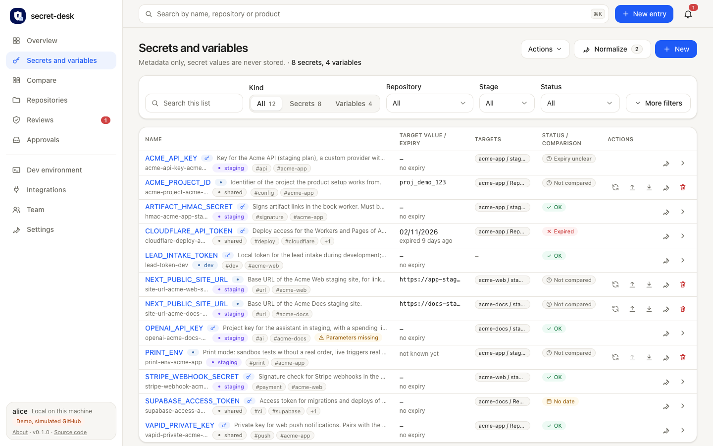
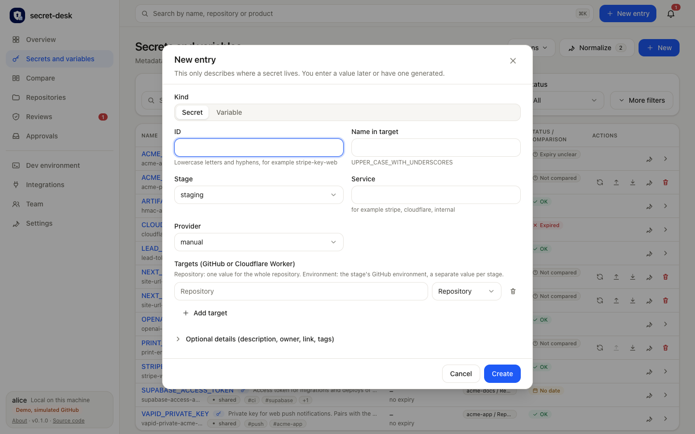

# Secrets and variables

The portal lists secrets and variables in **one table** at `/entries` (sidebar: *Secrets and variables*). Source: [`apps/desk/src/app/entries/page.tsx`](../apps/desk/src/app/entries/page.tsx), logic in [`apps/desk/src/lib/entries-list.ts`](../apps/desk/src/lib/entries-list.ts). The detail page of a secret stays at `/secrets/:id`; variables open their details in a dialog.

## Old addresses

`/secrets` and `/variables` redirect permanently (HTTP 308) to `/entries?kind=secret` and `/entries?kind=variable`. The query string is kept, so old bookmarks such as `/variables?repo=web&q=url` still work. The old German `/variablen` redirects the same way, and `?neu=1` still opens the new-entry dialog.

## The toolbar

All filters sit in **one toolbar** above the table: a search field, the *Kind* switch, *Repository*, *Stage* and *Status*. *Provider*, *Parameters*, *Group by* and *Sort by* are behind **More filters**; the button shows how many of them are active and opens by itself as soon as one is. While any filter is active a **Reset** button appears and clears them all. The number of entries sits next to the subtitle, for example "8 secrets, 4 variables". The primary action **New** is in the page header, next to *Actions* and *Normalize*.

## The kind switch

*Kind: All | Secrets | Variables* is part of the toolbar; the numbers show how many entries each choice would list under the other filters. The choice is in the URL: `?kind=secret` or `?kind=variable` (anything else means all).

Other filters in the URL: `stage`, `status`, `repo`, `tag`, `q`. Example: `/entries?stage=production&status=missing` (used by links from Compare, Overview and Repositories). *Group by* and *Sort by* apply to both kinds.

## Columns

Name (id, description, tags), Kind, Stage, Target value / expiry, Targets, Status / comparison, Actions. The table fits the window without horizontal scrolling: below 1280 px kind, stage, value and targets move into the name cell, below 640 px status and actions do too. Every row has the same actions cell, vertically centered. The count next to the subtitle counts the visible rows: for example "117 secrets, 93 variables".

| | Secret | Variable |
| --- | --- | --- |
| Target value / expiry | expiry date and days left | the target value |
| Status / comparison | expiry state, provider, last confirmation | comparison with GitHub (after *Compare*) |
| Actions | edit, open details | compare, set in GitHub, adopt, edit, remove |

Secret values are never shown or searched. The list receives metadata only.

## Filters that exist for one kind only

* **Status** has expiry states for secrets (*OK*, *Expiring soon*, *Due*, *Expired*, *Missing in GitHub*, *Date missing*, *Expiry unclear*) and comparison states for variables (*Not compared*, *Differs*, *Unreachable*, ...). *OK* and *Missing in GitHub* exist for both (for a variable, *OK* means *In sync*). Under *All* the one-kind values are marked "secrets only" or "variables only".
* **Provider** (automatic or manual) and **Parameters** exist for secrets only.

A filter is never applied silently to the other kind: when it hides a kind, a notice names the filter and the kind. With *Kind: Variables* the secret-only filters are hidden and not applied. Comparison states are only known after a comparison, so a status filter that needs one shows a notice with **Compare now** for the variables that were not compared yet.

## New

**New** opens one dialog with *Kind: Secret | Variable* at the top, preselected from the kind filter (secret under *All*) or from `?new=secret|variable` (`?new=1` takes the kind filter). The dialog asks for the required fields first (ID, name in target, stage, service, provider, targets). Title, product, expiry, description, owner, link and tags are in a closed section, *Optional details*, which opens by itself when an entry already has a description. *Create* and *Cancel* sit in a fixed footer, so they stay visible however long the form is.

## Bulk actions

The **Actions** menu holds *Sync secrets with GitHub*, *Complete parameters*, and for variables *Compare all*, *Adopt all from GitHub* and *Suggest values from providers*. They act on the rows that are visible.
