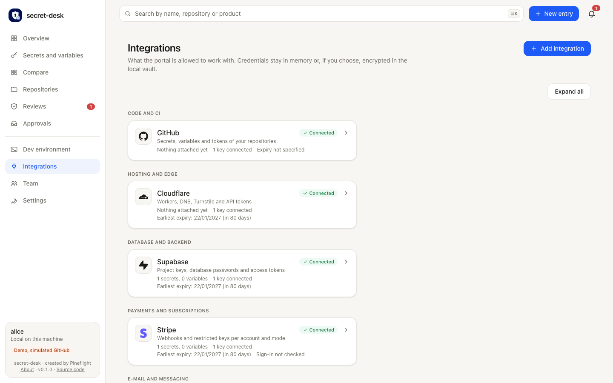
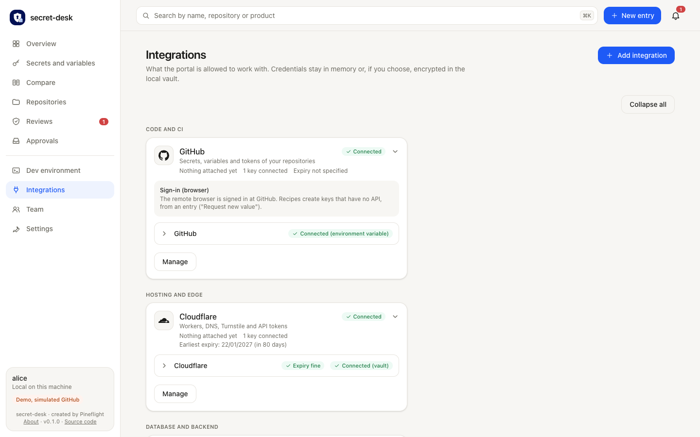
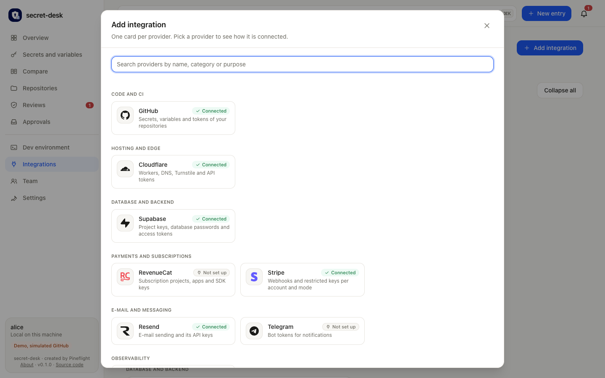
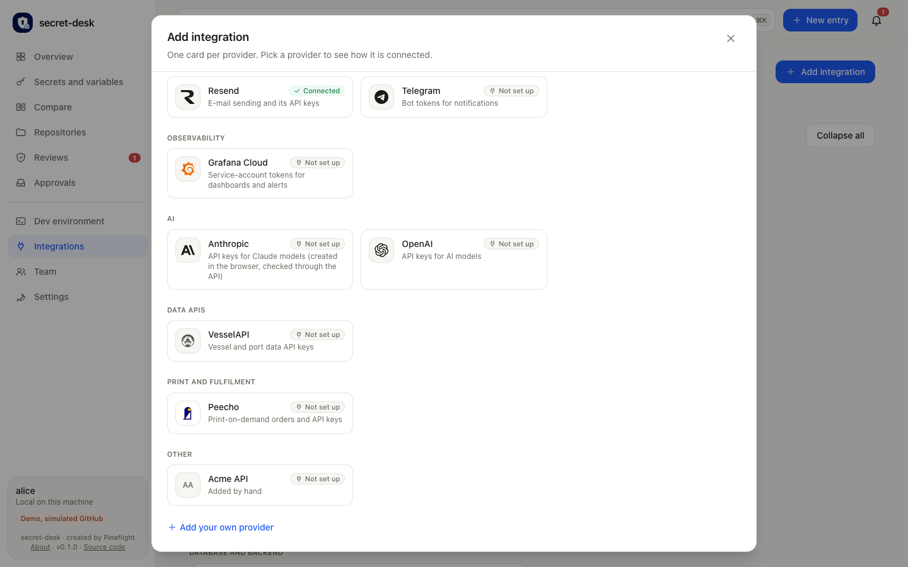

# Integrations

An **integration** is a connection to GitHub or to a provider: an access token that secret-desk uses to write secrets or to create, check and revoke tokens at the provider. The **Integrations** page shows the state of each connection, a guide with the exact permissions, and tests.

## The page

The page header holds **Expand all** / **Collapse all** and **Add integration**. Under it the **Live check** is one compact bar: its title, a status badge (*Never run*, *Running*, *All good*, *Problems found*), the time of the last run, *Details and explanation* and the button **Check now**. The details open by themselves when something failed; you can close or open them yourself. What the check does and how to read a report: [TROUBLESHOOTING.md](TROUBLESHOOTING.md#reading-the-live-check).

The provider cards below are a grid: one column on a phone or tablet, two from 1024 px width, three from 1536 px. Each card carries a small category label above the name (*Code and CI*, *Hosting and edge*, ...), and the buttons for the next step (*Set up*, *Connect with sign-in*) sit in the card header.

## One card per provider

The page and the **Add integration** picker show **one card per provider** (GitHub, Stripe, Cloudflare, Supabase, Resend, RevenueCat, Grafana Cloud, OpenAI, Anthropic, VesselAPI, Peecho, Telegram), grouped by category: Code and CI, Hosting and edge, Database and backend, Payments and subscriptions, E-mail and messaging, Observability, AI, Data APIs, Print and fulfilment, Other. The picker is a wide dialog (up to 960 px) with a search over name, category and purpose and a grid of tiles with logo, name, a one-line purpose and the status (*Connected*, *Sign-in active*, *Not set up*). Technical connection ids such as `github-app-key` or `cloudflare-turnstile` are not entries of their own: they sit under the card of their provider.

**Cards are collapsed.** A card on the page shows the logo, the name, one line about its purpose, the status, how many secrets, variables and keys depend on it, the key that **expires first** ("Earliest expiry: 12/12/2026 (in 3 days)", in red when it is under a week away) and, for providers with a guided sign-in, the sign-in state (*Signed in*, *Not signed in*, *Sign-in not checked*, *Check waiting*). Click the card (or press Enter or Space on it) to open it; inside, every connected key is again one compact row (name, expiry badge, source) that opens to its fingerprint, defaults, test and write test. *Expand all* / *Collapse all* sits in the page header. What you opened is remembered in this browser (local storage); without storage everything starts collapsed.

*Check sign-in* checks **only that provider**. The remote browser runs one thing at a time, so checks you start on several cards run one after the other; the others show *Check waiting*. If the browser is busy with a sign-in or a key run, the check says so (*The browser is busy with another run*) and can be repeated. A check that cannot be made says why, in the interface language (the page did not open, the browser is not reachable). On a card with a browser sign-in, *Open browser* opens the remote browser window. The remote browser's own state, the viewer address, the recipe list with status and SHA-256, and recipe problems are not on this page: they are for people who build integrations and are under *Settings*, *Developer* ([DEVELOPING-INTEGRATIONS.md](DEVELOPING-INTEGRATIONS.md)).

**Status of a provider whose keys come from the browser.** A provider with no API connection but a loaded recipe is no longer "Not set up" just because nothing is connected. The server remembers, per recipe host, in `sign-in-state.json` next to the repository links file (`~/.secret-desk/`, mode 600; host, yes/no, time and source only, written atomically, a damaged file is ignored), so a restart no longer turns every card into *Sign-in unknown*. It remembers when the browser was last seen signed in or out: a *Check sign-in* (guided sign-in or, for a recipe with a `login.form`, `POST recipes/<id>/check`), a finished guided sign-in or a **successful recipe run**. The card shows **Ready (browser)** with "checked 3 hours ago" while the last answer is younger than `automation.signInFreshHours` (default 12, because provider sessions often last about a day) and says yes; **Sign-in needed** when a fresh answer says no (with *Open browser*); **Sign-in unknown** (neutral, not red) with "Check again" when the answer is older or missing but entries use the recipe; **Not set up** only when there is neither a connection nor a usable sign-in answer. The card also counts the entries the browser manages ("2 secrets, managed by the browser") and shows the earliest expiry among them. A card with an **API connection** ignores the browser state: it says "Works without browser sign-in: keys are issued through the API" (RevenueCat, OpenAI). The threshold logic is a pure helper, [`browser-ready.ts`](../apps/desk/src/lib/browser-ready.ts).

**Checked in the background, warned ahead.** Every `automation.signInCheckHours` hours (default 6, `0` = off) the portal checks the browser sign-in of each recipe host whose last answer is older, one check at a time through the same browser queue and never while another run is active (a failed check is tried again after 30 minutes). The log gets one line per result (`scheduled sign-in check <host>: signed in | signed out | failed (<code>)`), never a value. From the answers the server also measures how long a sign-in lasts at a host: the time from the start of a seen sign-in to the midpoint between the last *signed in* and the first *signed out* answer (a sign-in the portal did not see start is not measured). The provider card then says "Sessions here last about 22 h"; *Settings*, *Developer* lists every host with its last answer and lifetime. An entry whose value a recipe creates and that expires within `automation.renewalWarnDays` days (default 7, `0` = off) while the browser is signed out or unknown at that provider gets a notice on the overview and the badge *Sign-in needed before renewal on <date>* in the entries list, each with *Sign in*, which opens that provider's sign-in dialog on this page (`/connections?signin=<provider>`), never the remote browser. A provider with a connected API key is exempt: it renews without the browser. The warning rules are the pure helper [`renewal-warning.ts`](../apps/desk/src/lib/renewal-warning.ts).

Under a card, the provider's **ways in**, each explained in one sentence:

| Way in | What it is | Example |
|---|---|---|
| **Sign-in (browser)** | The remote browser is signed in at the provider. Recipes create keys that have no API; for providers with a [guided sign-in](#guided-sign-in-provider-facade) the sign-in also creates the integration keys itself. | Stripe: per account and mode. RevenueCat: per project. |
| **API keys** | The keys secret-desk uses to call the provider's API (webhooks, account checks, discovery). For a provider with a guided sign-in they are **created and renewed by the sign-in** and listed as rows; pasting a key stays available under a collapsed *I already have a key*. | *Stripe Acme Studio (Sandbox)*, *Stripe Acme Studio (Live)* |
| **By hand** | Only what no API and no recipe can produce, for example an account password or a value the provider sends by e-mail. | Telegram bot token |

**Why Stripe has no separate sandbox, live and general connections any more:** you sign in once; secret-desk creates the restricted keys it needs for each account and mode and keeps them as `stripe:<acct_id>:<mode>`. You do not manage *Stripe (Sandbox)*, *Stripe (Live)* and *Stripe* separately. The older connections `stripe`, `stripe-test` and `stripe-live` stay readable and appear under the Stripe card as *older connection*, with a hint to replace them by the per-account ones. Nothing is deleted automatically.

**Anthropic:** the dialog asks how to connect: *Team organization* (an Admin key: workspaces, checking and deactivating keys through the API) or *Personal (individual)* (a normal API key that the portal only checks; workspaces and deactivation through the API are not available). Both use the same Console sign-in and become the `anthropic` connection. Creating an API key is only possible in the Console, so it always runs through the signed-in browser (the Admin API cannot create keys). Its email sign-in is passwordless: the portal asks for the emailed code, not a password.

**Lines per account.** A provider with keys per account and mode (Stripe) lists every connection as one compact line on its card: the account (the Stripe account name, else its id), the mode (*Sandbox*, *Live*), the validity of the key and the actions *Test*, *Reconnect* (opens the connect dialog with that account and mode filled in) and *Remove*. *Connect another account* opens the dialog empty. The older connections (`stripe`, `stripe-test`, `stripe-live`) are one *older connection* line with the hint to replace them. The same layout applies to any provider that declares connection prefixes. Key values are never shown.

**Connect on every guided provider.** A provider with a guided sign-in (Stripe, RevenueCat, OpenAI, Anthropic) always offers *Connect with sign-in* or *Reconnect with sign-in* on its card, also when it has recipes with a browser sign-in of their own. If the list of guided sign-ins could not be loaded, the page says so and offers *Try again*; the button is still there and the dialog reads the real state.

**Expiry text.** Values a browser recipe reads and that never expire (read-only keys, `expiry: none`, Peecho) show *Does not expire* and are left out of the earliest-expiry calculation. A check that is queued or running shows as a status next to its line (*Live: waiting for the browser …*); buttons only name the action (*Check live*).

**Sign in at a browser-only vendor.** A provider whose keys come from recipes and that has no sign-in dialog of its own (Peecho, VesselAPI, Supabase, GitHub outside the team token flow) shows *Sign in* next to every sign-in line that says *Sign-in needed* or *Sign-in unknown*, one per portal when the recipe has several (*Sign in at live*, *Sign in at test*); the same button is in the details of the card and under *Manage*, and the *Sign in* link of a renewal warning opens this dialog. The dialog is the one of the guided providers without the key part: you choose the way to sign in (email, or Apple, Google, Microsoft, GitHub where the recipe offers it), enter the details in the portal (this run only, typed only on the recipe's host, wiped afterwards), answer the one-time code, the approval on your device or the authorization there, and see each step. It only signs in: no key is created and nothing is stored. A successful sign-in is remembered for that host, so the card says *Signed in* and the renewal warning goes away. You never leave the portal. If the browser is busy with another run, the sign-in is refused with that message and can be repeated.

The page lists the providers that are set up or have secrets or variables attached; the counts include secrets that a browser recipe creates for that provider. *Check sign-in* asks the remote browser whether it is still signed in (no credentials, nothing typed). A provider whose recipe is planned but does not exist yet shows *Recipe coming* as its sign-in way (none does at the moment: Peecho has the read-only recipe `peecho-api-keys`).

Which connection, provider definition or recipe belongs to which card, and which category it is shown under, is defined in one place, [`vendors.ts`](../packages/core/src/vendors.ts) (served by `GET vendors`); the texts are in the interface catalogs (`vendor.<id>.purpose`, `category.<id>`).

**Logos** come from the [`simple-icons`](https://simpleicons.org) package (CC0-1.0; the brands themselves are trademarks of their owners and are shown only to mark the provider). `node scripts/brand-icons.mjs` copies the few icons the catalog uses into `apps/desk/src/lib/brand-icons.generated.ts`, so the page bundles them and loads nothing from outside (the CSP allows no foreign images). Marks that simple-icons lacks (OpenAI, VesselAPI, Peecho) are kept by hand in `apps/desk/src/lib/brand-icons.custom.ts`, each with its source; such a mark may carry `layers` and is then drawn in its own colours on a white tile in both themes (Peecho); a provider with neither (providers you add yourself) gets a neutral monogram. A logo keeps its brand color only where that color has at least 3:1 contrast on both a light and a dark surface; otherwise it follows the text color.

Create every token with **no more than** the permissions below, with a short expiry. Guides are in [`connection-guides.ts`](../packages/runtime/src/connection-guides.ts); the **Guide** button on each card shows the same.

## Connecting a token

1. Open the card and paste the token.
2. State **until when the token is valid** (a date in the future) or "never expires". This is required: it feeds the expiry warnings on the card.
3. Choose where it lives:
   - **For this session**: in memory until the portal stops (default).
   - **Store encrypted on this machine** ([vault](#vault)): kept across restarts.
4. Click **Test connection**.

For Stripe the key's prefix is checked: the sandbox connection takes `rk_test_`, the live connection `rk_live_` (also `stripe:<acct_id>:sandbox` / `:live`); a mismatch is rejected.

Instead of pasting, the configuration can point to an environment variable or a 1Password reference ([CONFIGURATION.md](CONFIGURATION.md#connection-sources)). **Resolution order** when a token is needed: session, then vault, then the configured source. An expired session or vault token is reported instead of silently falling back.

A token that never expires and has been stored for more than 90 days is flagged on the card.

## Permissions and recommended flow

### GitHub

Why: writes secrets and variables, reads which names exist. All values end up here.

Fine-grained personal access token, restricted to the repositories the portal should manage:

| Permission | Level | |
|---|---|---|
| Secrets | Read and write | |
| Variables | Read and write | |
| Environments | Read and write | needed for environment secrets |
| Metadata | Read | |
| Contents | Read | optional: workflow files for [Compare](COMPARE.md#workflow-needs) |

For organization secrets also the organization permission *Secrets* (Read and write). Recommended expiry: 90 days. The Guide opens the GitHub form with name, owner, expiry and permissions prefilled; you choose the repositories yourself.

A **GitHub App** is an alternative (`github.auth.type: app`): the portal then obtains a token valid for one hour per run. The installation token is requested with `secrets: write`, `environments: read` and `metadata: read` only, so variables and workflow files are not available in App mode.

**Team sync with a GitHub App.** [Team sync](TEAM.md#team-sync-with-a-private-github-repository) asks for its own installation token per operation (one check, take-over or push; never cached across operations), only for the team repository and only with `contents` (read; write to push), `pull_requests` (write, pull-request strategy only) and `metadata: read`. Add *Contents* and *Pull requests* to the App's permissions (App settings, Permissions and events) and make sure the installation includes the team repository, otherwise GitHub refuses the token (the connection test says so). These extra App rights are only used for team sync.

### Cloudflare (`cloudflare`)

Why: creates, checks and revokes further Cloudflare tokens (`cloudflare-token`), Access service tokens (`cloudflare-access-service-token`) and R2 S3 key pairs (`cloudflare-r2-credentials`).

Template **Create additional tokens** (*User > API Tokens > Edit*), nothing else. A token that can create tokens can grant access to everything your user can reach, so set a short expiry (1 to 7 days) and, if possible, an IP restriction. Keep it for the session.

No extra permission is needed for Access service tokens: the connection token only has to be able to create tokens. For each issuance the provider creates a helper token with *Access: Service Tokens Write* limited to one account and ten minutes, uses it for the Access call and deletes it again (see [PROVIDERS.md](PROVIDERS.md#cloudflare-access-service-tokens-client-id-and-secret-together)). The connection token itself never needs the Access permission.

R2 S3 credentials are created as an account-owned API token, which needs the account-level permission to edit API tokens; the *Create additional tokens* template (a user token) may not be enough. Not verified live. Resolving zone names (`zones`) needs a read permission for zones, `allZones` does not (see [PROVIDERS.md](PROVIDERS.md#several-zones-terraform-and-cloudflare-for-saas)).

### Cloudflare Turnstile (`cloudflare-turnstile`)

Why: renews the secret of a Turnstile widget. A separate connection, because the permission to create tokens cannot be combined with other permissions.

Custom token with *Account > Turnstile > Edit*, limited to the account that owns the widget.

### Supabase (`supabase`)

Why: reads, creates and deletes API keys of Supabase projects and sets their database password through the Management API.

Access token with *API Keys* Read-write and *API Key Secrets* Read; optionally *Project Settings* Read and *Projects* Read, and *Database config* Write (fine-grained permission `database_config_write`), needed only for `supabase-db-password`. Limit the token to the organization or projects to manage. A token never exceeds your own role (Owner or Admin needed). A full-access ("legacy") token works but is not recommended. The token is shown only once.

### Stripe (`stripe:<acct_id>:<mode>`, `stripe-test`, `stripe-live`, `stripe`)

Why: creates and revokes webhook endpoints and reads their signing secrets.

Restricted key with all resources `None` and only *Webhook Endpoints, Event Destinations* `Write`. Optionally *Balance* `Read`, so the test can confirm the key. One key per mode: `stripe-test` (sandbox, `rk_test_`) is preferred for stages of kind `test`, `stripe-live` (`rk_live_`) for kind `live`, if connected; the general `stripe` connection is the fallback, and `dev` and `shared` stages always use it. An entry's parameter `connection` overrides the choice. For several products in one Stripe organization use one connection per account and mode, `stripe:<acct_id>:sandbox` and `stripe:<acct_id>:live`, and set `account` on the entry (see [PROVIDERS.md](PROVIDERS.md#stripe-one-connection-per-account-and-mode)); the connection then verifies that its key belongs to that account.

### Resend (`resend`)

Why: creates, lists and revokes Resend API keys.

An API key with **Full access** (only this type can manage API keys). The keys secret-desk creates are narrow: *Sending access*, optionally limited to a domain.

### RevenueCat (`revenuecat`)

Why: reads projects, apps and **public** SDK keys so variables such as the project id, the app ids and the SDK keys do not have to be typed. Read only.

A **v2 secret API key** (starts with `sk_`; v1 keys do not work with API v2) with **Project configuration: Read only** and every other area on `None`. Create it under Project settings, API keys, "+ New secret API key" (`https://app.revenuecat.com/projects/<project id>/api-keys/new`). The key is never written anywhere by secret-desk; only public values and identifiers are read from it.

### Grafana Cloud (`grafana`)

Why: creates and revokes tokens of service accounts in a Grafana stack.

A service account for secret-desk with role Admin (so it can manage tokens of other service accounts), and a short-lived token for it. The stack address and the target service account id are parameters of the inventory entry; allowed hosts are `*.grafana.net` plus `providers.grafana.allowedHosts`.

The card links to `https://grafana.com/profile/org` (forwards signed-in users to their own organization; `grafana.com/orgs` needs an org slug and answers 404). As soon as a stack address is known (integration default `baseUrl` or any Grafana entry), the card's direct link is `<baseUrl>/org/serviceaccounts`. Steps: open the stack, Administration, Users and access, Service accounts.

### Grafana Cloud account (`grafana-cloud`, optional)

Why: creates and revokes access policy tokens (`grafana-access-policy-token`) of a Grafana Cloud organization on grafana.com, for example for Terraform or a log shipper. Unlike `grafana` it is not tied to a stack.

An access policy for secret-desk with only the scopes `accesspolicies:read`, `accesspolicies:write` and `stacks:read`, plus `accesspolicies:delete` (revoke tokens) and `stack-service-accounts:write` (create service accounts in a stack through the Cloud API) if grafana.com offers them (the last two names are from memory), and a token with a 90-day expiry for it. The region and the id of the target policy are parameters of the inventory entry. The API shapes are not verified live.

It is created by the **guided sign-in** of the Grafana card (*Connect with sign-in*, facade `grafana`, recipe `grafana-cloud-access-policy`): you sign in at grafana.com in the portal (email and password, Google, GitHub or Microsoft; one-time codes are asked for in the portal), and the signed-in browser creates the policy and the token, which the portal stores as `grafana-cloud` and tests. The card then shows both connections as lines (the stack token you paste, the account token the sign-in made); the keys section of the dialog offers *Connect with sign-in* on the account line and *Set up* on the stack line. Nothing of this flow is verified live. With the account token the portal can create stack service accounts and tokens through the Cloud API when the stack token cannot ([PROVIDERS.md](PROVIDERS.md#grafana-service-accounts-without-manual-steps)).

## Guided sign-in (provider facade)

For providers whose keys exist only with a user account, *Integrations* has *Connect with sign-in* (RevenueCat and Stripe today). Flow: when the dialog opens it checks the browser sign-in first; a signed-in browser connects directly (*Connect with the signed-in browser*, no password), otherwise you choose a sign-in method (email and password, or single sign-on with Apple, Google, Microsoft or GitHub where the recipe offers it) and enter the credentials in the portal (this run only, never stored); the portal signs in through the remote browser (`automation.cdpEndpoint`) and shows each step with elapsed time and time limit; a one-time code is typed in the portal, an approval is awaited, a device approval is shown as "Approve the sign-in on your device ..."; a CAPTCHA cannot be solved by the script and ends the run with a message and *Try again*, nobody is sent to the browser; then the facade creates the integration key (RevenueCat: v2, *Project configuration: Read only*, no expiry, name `secret-desk-integration-<date>-<time>`), stores it as the connection (vault, else this session), runs *Test connection* and reports e.g. "1 project, 3 apps". The project is read from the dashboard address after sign-in; if that fails, enter the project id and connect (the browser stays signed in). *Check sign-in* needs no credentials. Pasting a key stays available as the collapsed *I already have a key*. **Stripe** also asks for the account id (`acct_...`) and the mode (`sandbox` or `live`), because one Stripe organization holds several accounts: the facade creates the restricted key (*Webhook Endpoints, Event Destinations: Write*, named `secret-desk-<test|live>-<date>-<time>`) with the recipe `stripe-restricted-key`, checks with `GET /v1/account` that the key belongs to that account and mode **before** storing it, stores it as `stripe:<acct_id>:<mode>` and tests it. A wrong key is not stored and the portal names the key to expire. The live mode may ask for the password again; the portal then says it waits for you in the browser window. The recipe for the sign-in form itself is not verified. Adding a provider means a descriptor in `packages/runtime/src/facade.ts` plus a recipe with `login.form`; `inputs` lists the recipe parameters the human chooses per run. Verification: see [ROADMAP.md](ROADMAP.md).

## Resources and defaults

Besides the permissions above, each card has **Resources and defaults**. The portal uses the same token, read-only, to list the accounts, projects, zones, domains or service accounts it can see, so entries can pick a resource from a list instead of typing an id, and to store non-secret **defaults** per integration. How the lists, suggestions and the preflight work: [RESOURCES.md](RESOURCES.md).

| Integration | What is listed | What the token must be allowed to read | Defaults |
|---|---|---|---|
| Cloudflare (`cloudflare`) | accounts, zones, permission groups | Accounts and zones need a read permission (for example *Account Settings Read* for accounts, a zone read permission for zones). The template *Create additional tokens* has none: enter the account id once by hand as the default (dashboard, account overview, copy the account id). Permission groups can always be listed. The connection page then shows "0 found" for accounts and zones with a hint saying exactly this. | `accountId` |
| Cloudflare Turnstile (`cloudflare-turnstile`) | accounts, Turnstile widgets | *Account > Turnstile > Edit* lists the widgets of the account; the account list needs a read permission as well, otherwise enter `accountId` by hand. | `accountId` |
| Supabase (`supabase`) | projects | The optional *Projects* Read (see above). Without it the list is empty or unreadable: enter the project ref by hand. | none |
| Resend (`resend`) | domains and their verification status | Domains can only be listed with **Full access** (the same key type the connection needs anyway). | none |
| RevenueCat (`revenuecat`) | projects, apps (with type) and, for variables, the public SDK keys of an app | *Project configuration: Read only* (`project_configuration:projects:read` and `project_configuration:apps:read`). | `projectId` |
| Grafana (`grafana`) | service accounts of the stack | The Admin service account of the connection; needs the stack address first. | `baseUrl` |
| GitHub, Stripe | nothing | | none |

If a list cannot be read, the card says so and the pickers on the entries fall back to *Enter the value by hand*. Nothing breaks: only the convenience is missing. See [TROUBLESHOOTING.md](TROUBLESHOOTING.md#parameters-and-resources).

## Test connection

A button on every connected card (`POST /api/ui/connections/<id>/check`, portal only, never available to agents). It makes **read-only** calls with the stored token:

| Connection | Call | What it shows |
|---|---|---|
| GitHub | `GET /user`, then a public-key read for every target in the inventory, and a workflow-files read | login, token expiry (header `github-authentication-token-expiration`), missing permissions per target, whether Contents is readable |
| Cloudflare | `GET /user/tokens/verify` | status, expiry (`expires_on`); more than 7 days for the creating token gets a recommendation |
| Supabase | `GET /v1/organizations` | token valid |
| Stripe | `GET /v1/balance`; for `stripe:<acct_id>:<mode>` also `GET /v1/account` | key valid and mode; a 403 on a restricted key is normal (information); the key belongs to the account of the connection id (and its name becomes the label) |
| Resend | `GET /api-keys` | 401 or 403 means the key lacks Full access |
| RevenueCat | `GET /v2/projects?limit=1` | 401 invalid key, 403 lacks *Project configuration: Read only*, 429 rate limit (60 requests per minute), a key not starting with `sk_` is flagged |
| Grafana | none | Cannot be tested without a stack address; checked when issuing |
| Grafana Cloud account (`grafana-cloud`) | `GET https://grafana.com/api/v1/accesspolicies?region=us` | 200 connected, 401 rejected, 403 valid but may not list policies; a token that does not start with `glc_` is the wrong kind (not verified live) |
| GitHub App key | none | Checked on first access: test through the GitHub connection |

An expiry reported by the provider is shown on the card instead of the manual entry. Messages never contain the token.

### Write test

GitHub only, opt-in, never automatic. It proves that the token may write. Open **Write test**, choose targets (repository or environment ids from the inventory; live stages are never preselected) and run it. For each chosen target the portal:

1. checks that no secret `SD_WRITE_PROBE` (variable `SD_WRITE_PROBE_VAR`) exists yet, and leaves an existing one untouched;
2. creates the probe with a throwaway value (the secret sealed with the target's public key, as for any other secret);
3. deletes it again immediately.

If the deletion fails the result names the probe and the target so you can remove it by hand. At most 40 targets are tested. See [SECURITY-MODEL.md](SECURITY-MODEL.md#write-test).

## Vault

The vault stores integration tokens encrypted so you do not need to enter them at every start. It never stores the values that secret-desk manages (those live only in GitHub).

- **Encryption:** AES-256-GCM. A hash would not work: the token must be usable again.
- **Key:** never next to the data. In this order: environment variable `SECRET_DESK_VAULT_KEY` (32 bytes, Base64), `vault.keyFile` if set, then the system keychain: macOS Keychain, Linux `secret-tool` (libsecret), Windows DPAPI (blob in `<vault>.key`, openable only by the same Windows account on the same machine).
- **File:** `~/.secret-desk/vault.json` (mode 600; `vault.file`). Only a missing file means an empty vault. A damaged file is an error, a copy is kept as `vault.json.corrupt-<time>`, and it is never overwritten.
- **Cards** show a short fingerprint (first characters of the token's SHA-256) so you can recognize the token without seeing it.
- **Turn it off** with `vault.enabled: false`.
- **Without a keyring** (Linux server, container): the vault says so and stores nothing in plain text. Set `SECRET_DESK_VAULT_KEY` or `vault.keyFile` (key and data on the same disk then).
- **On macOS** a new key is created only when the keychain reports the item as missing; any other failure (locked, denied) is an error and overwrites nothing.

To remove a stored token, use **Disconnect** on the card.
