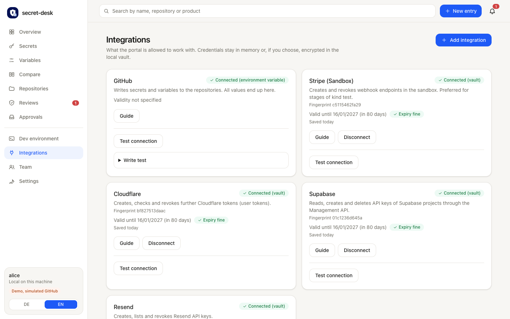

# Integrations

An **integration** is a connection to GitHub or to a provider: an access token that secret-desk uses to write secrets or to create, check and revoke tokens at the provider. The **Integrations** page shows the state of each connection, a guide with the exact permissions, and tests.

Create every token with **no more than** the permissions below, with a short expiry. Guides are in [`connection-guides.ts`](../packages/runtime/src/connection-guides.ts); the **Guide** button on each card shows the same.

## Connecting a token

1. Open the card and paste the token.
2. State **until when the token is valid** (a date in the future) or "never expires". This is required: it feeds the expiry warnings on the card.
3. Choose where it lives:
   - **For this session**: in memory until the portal stops (default).
   - **Store encrypted on this machine** ([vault](#vault)): kept across restarts.
4. Click **Test connection**.

For Stripe the key's prefix is checked: the sandbox connection takes `rk_test_`, the live connection `rk_live_`; a mismatch is rejected.

Instead of pasting, the configuration can point to an environment variable or a 1Password reference ([CONFIGURATION.md](CONFIGURATION.md#connection-sources)). **Resolution order** when a token is needed: session, then vault, then the configured source. An expired session or vault token is reported instead of silently falling back.

A token that never expires and has been stored for more than 90 days is flagged on the card.

## Permissions and recommended flow

### GitHub

Why: writes secrets and variables, reads which names exist. All values end up here.

Fine-grained personal access token, restricted to the repositories the portal should manage:

| Permission | Level | |
|---|---|---|
| Secrets | Read and write | |
| Variables | Read and write | |
| Environments | Read and write | needed for environment secrets |
| Metadata | Read | |
| Contents | Read | optional: workflow files for [Compare](COMPARE.md#workflow-needs) |

For organization secrets also the organization permission *Secrets* (Read and write). Recommended expiry: 90 days. The Guide opens the GitHub form with name, owner, expiry and permissions prefilled; you choose the repositories yourself.

A **GitHub App** is an alternative (`github.auth.type: app`): the portal then obtains a token valid for one hour per run. The installation token is requested with `secrets: write`, `environments: read` and `metadata: read` only, so variables and workflow files are not available in App mode.

### Cloudflare (`cloudflare`)

Why: creates, checks and revokes further Cloudflare tokens (`cloudflare-token`).

Template **Create additional tokens** (*User > API Tokens > Edit*), nothing else. A token that can create tokens can grant access to everything your user can reach, so set a short expiry (1 to 7 days) and, if possible, an IP restriction. Keep it for the session.

### Cloudflare Turnstile (`cloudflare-turnstile`)

Why: renews the secret of a Turnstile widget. A separate connection, because the permission to create tokens cannot be combined with other permissions.

Custom token with *Account > Turnstile > Edit*, limited to the account that owns the widget.

### Supabase (`supabase`)

Why: reads, creates and deletes API keys of Supabase projects through the Management API.

Access token with *API Keys* Read-write and *API Key Secrets* Read; optionally *Project Settings* Read and *Projects* Read. Limit the token to the organization or projects to manage. A token never exceeds your own role (Owner or Admin needed). A full-access ("legacy") token works but is not recommended. The token is shown only once.

### Stripe (`stripe-test`, `stripe-live`, `stripe`)

Why: creates and revokes webhook endpoints and reads their signing secrets.

Restricted key with all resources `None` and only *Webhook Endpoints* `Write`. Optionally *Balance* `Read`, so the test can confirm the key. One key per mode: `stripe-test` (sandbox, `rk_test_`) is preferred for stages of kind `test`, `stripe-live` (`rk_live_`) for kind `live`, if connected; the general `stripe` connection is the fallback, and `dev` and `shared` stages always use it. An entry's parameter `connection` overrides the choice.

### Resend (`resend`)

Why: creates, lists and revokes Resend API keys.

An API key with **Full access** (only this type can manage API keys). The keys secret-desk creates are narrow: *Sending access*, optionally limited to a domain.

### Grafana Cloud (`grafana`)

Why: creates and revokes tokens of service accounts in a Grafana stack.

A service account for secret-desk with role Admin (so it can manage tokens of other service accounts), and a short-lived token for it. The stack address and the target service account id are parameters of the inventory entry; allowed hosts are `*.grafana.net` plus `providers.grafana.allowedHosts`.

## Test connection

A button on every connected card (`POST /api/ui/connections/<id>/check`, portal only, never available to agents). It makes **read-only** calls with the stored token:

| Connection | Call | What it shows |
|---|---|---|
| GitHub | `GET /user`, then a public-key read for every target in the inventory, and a workflow-files read | login, token expiry (header `github-authentication-token-expiration`), missing permissions per target, whether Contents is readable |
| Cloudflare | `GET /user/tokens/verify` | status, expiry (`expires_on`); more than 7 days for the creating token gets a recommendation |
| Supabase | `GET /v1/organizations` | token valid |
| Stripe | `GET /v1/balance` | key valid and mode; a 403 on a restricted key is normal (information) |
| Resend | `GET /api-keys` | 401 or 403 means the key lacks Full access |
| Grafana | none | Cannot be tested without a stack address; checked when issuing |
| GitHub App key | none | Checked on first access: test through the GitHub connection |

An expiry reported by the provider is shown on the card instead of the manual entry. Messages never contain the token.

### Write test

GitHub only, opt-in, never automatic. It proves that the token may write. Open **Write test**, choose targets (repository or environment ids from the inventory; live stages are never preselected) and run it. For each chosen target the portal:

1. checks that no secret `SD_WRITE_PROBE` (variable `SD_WRITE_PROBE_VAR`) exists yet, and leaves an existing one untouched;
2. creates the probe with a throwaway value (the secret sealed with the target's public key, as for any other secret);
3. deletes it again immediately.

If the deletion fails the result names the probe and the target so you can remove it by hand. At most 40 targets are tested. See [SECURITY-MODEL.md](SECURITY-MODEL.md#write-test).

## Vault

The vault stores integration tokens encrypted so you do not need to enter them at every start. It never stores the values that secret-desk manages (those live only in GitHub).

- **Encryption:** AES-256-GCM. A hash would not work: the token must be usable again.
- **Key:** never next to the data. In this order: environment variable `SECRET_DESK_VAULT_KEY` (32 bytes, Base64), `vault.keyFile` if set, then the system keychain: macOS Keychain, Linux `secret-tool` (libsecret), Windows DPAPI (blob in `<vault>.key`, openable only by the same Windows account on the same machine).
- **File:** `~/.secret-desk/vault.json` (mode 600; `vault.file`). Only a missing file means an empty vault. A damaged file is an error, a copy is kept as `vault.json.corrupt-<time>`, and it is never overwritten.
- **Cards** show a short fingerprint (first characters of the token's SHA-256) so you can recognize the token without seeing it.
- **Turn it off** with `vault.enabled: false`.
- **Without a keyring** (Linux server, container): the vault says so and stores nothing in plain text. Set `SECRET_DESK_VAULT_KEY` or `vault.keyFile` (key and data on the same disk then).
- **On macOS** a new key is created only when the keychain reports the item as missing; any other failure (locked, denied) is an error and overwrites nothing.

To remove a stored token, use **Disconnect** on the card.
