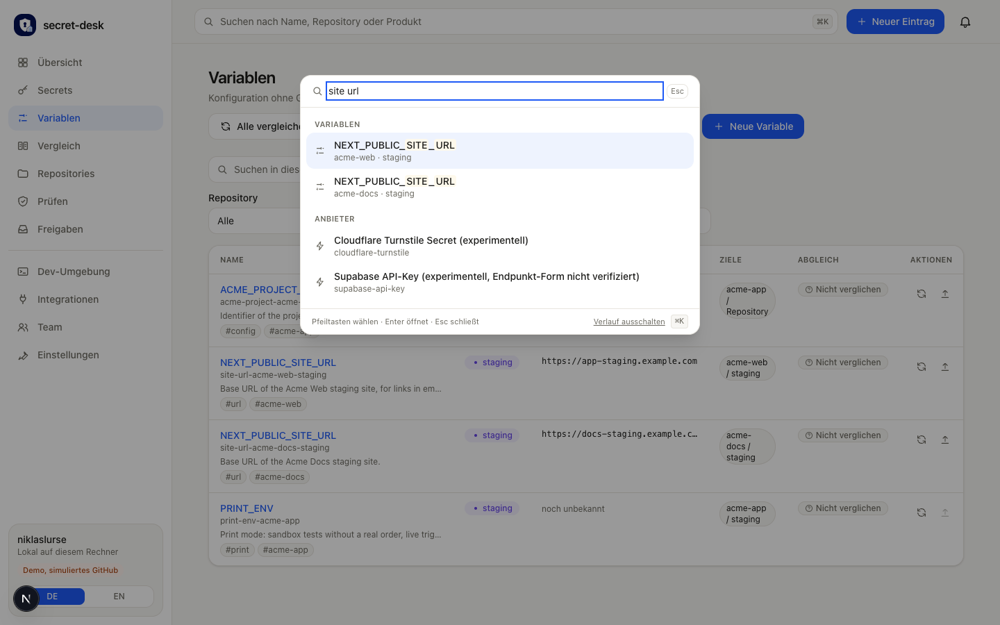

# Search and keyboard shortcuts

## Command palette
Press **⌘K** (macOS, iOS keyboards) or **Ctrl K** (Windows, Linux) anywhere in the portal. On touch devices there is a search button in the header instead of a shortcut. The palette searches only metadata and never values, tokens or the launch secret:

- secrets, variables (name, id, title, description, owner, tags, service/provider, repository, stage), repositories, stages, integrations, providers,
- pages and actions of the portal ("Go to compare", "Team sync", "Add an integration", "Generate dev .env"). Actions only open the page or dialog, they never run anything with side effects.

Results are grouped by kind with an icon, a subtitle (repository, stage) and a status badge (expired, due soon, missing in GitHub ...). **Arrow keys** move, **Enter** opens, **Tab** jumps to the next group, **Esc** closes. `/` still focuses the search field of a list page.

## How matching works
- Case, umlauts and separators do not matter: `STRIPE_SECRET`, `stripe secret` and `stripesecret` are the same search.
- Partial words, typos (`strpe`, `stirpe`) and initials (`ssk` finds `STRIPE_SECRET_KEY`) work. Several words must all match.
- Weighting: name, then id, then tags, then description. Ties are broken by what you opened recently.
- No hit: "Did you mean ..." offers the nearest known word.

## Filters
Type `key:value`; while you type a key or a value the palette suggests the valid ones.

| Filter | Example | Meaning |
|---|---|---|
| `stage:` | `stage:staging` | stage id |
| `repo:` | `repo:wake-miles` | repository |
| `tag:` | `tag:config` | tag |
| `art:` / `kind:` | `art:variable` | secret, variable, repo, stage, connection, provider, page, action |
| `besitzer:` / `owner:` | `owner:anna` | owner |
| `status:` | `status:fehlt`, `status:missing` | status of a secret (expired, due, soon, missing ...) |
| `anbieter:` / `provider:` | `provider:stripe` | provider or service |

Filters and words combine: `stage:staging repo:wake-miles token`.

## History
An empty search shows recently opened entries, recent searches and typical suggestions. They are kept only in this browser (`localStorage`: entry ids and search terms, never values). The palette footer turns the history off (which also deletes it) or clears it.

## Lists
The search fields of Secrets, Variables and Compare use the same logic (tolerant matching, filter syntax) and highlight the matches in the name and id.

## Accessibility
The palette is a modal dialog (`role="dialog"`, `aria-modal`) with a focus trap, returns focus to where you were, announces the number of results to screen readers and respects reduced motion.
