# UI guide

A short tour of the portal, one section per screen in the order of the sidebar. Each section says what you do there and where the main action is. All screenshots come from the demo (made-up data, simulated GitHub). The portal has the same layout at phone width; the 375 px captures are linked where they help.

Every screen follows one rule: the main action is in the first viewport. Page headers hold the primary buttons, filters sit in one toolbar, rarely used controls are in closed sections, and dialogs keep *submit* and *cancel* in a fixed footer. The top bar has a search field (the **⌘K** / Ctrl K badge opens the [command palette](SEARCH.md)), **New entry** and the bell for open reviews. The sidebar footer shows who you are, where the portal runs and the version.

## Overview

What you do here: see what is expired, due soon, missing or waiting for a review, then jump to it. The stat cards (*Expired*, *Due soon*, *Missing*, *Open reviews*) are links to the matching filtered lists. The *Needs attention* list comes before the integrations block and has stage tabs. A notice at the top says when a review waits for you, with *Review now*.

Main action: click the notice, a stat card or a row of the attention list.

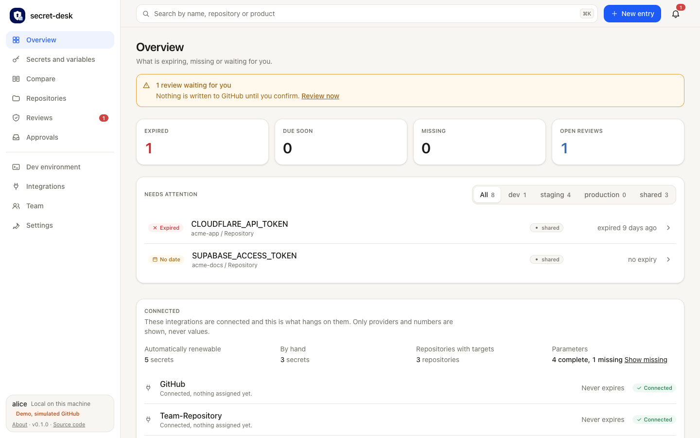

## Secrets and variables

What you do here: find an entry, check its status, open it, or create one. One list holds secrets and variables; the *Kind* switch narrows it.

Main action: **New** in the page header (next to *Actions* and *Normalize*). The toolbar has the search field, *Kind*, *Repository*, *Stage* and *Status*. *Provider*, *Parameters*, *Group by* and *Sort by* are behind *More filters*; *Reset* appears while a filter is active. The count sits next to the subtitle.

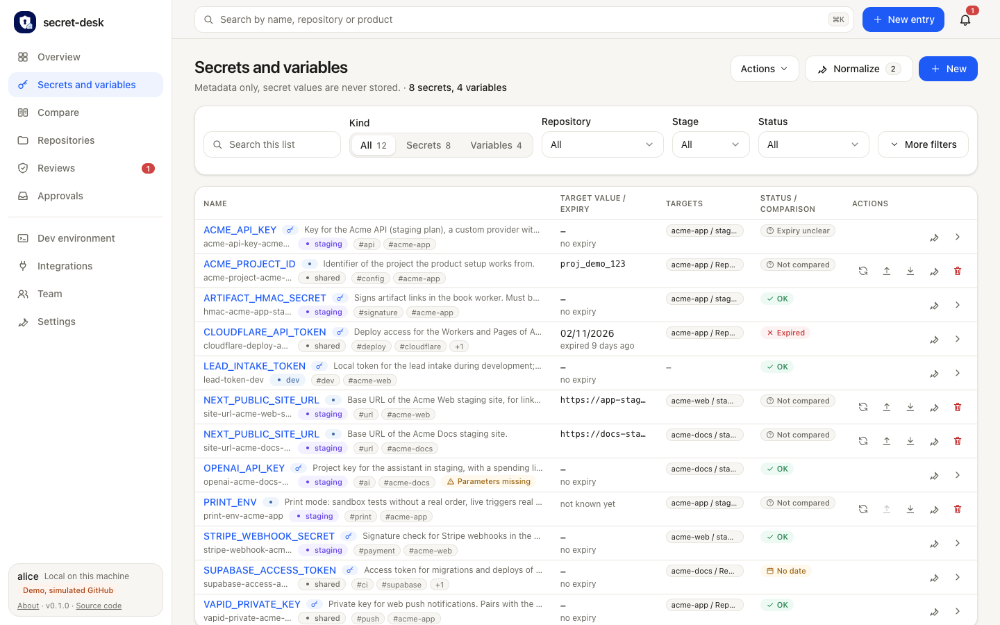

**New entry** (also the button in the top bar) asks for the required fields first: ID, name in target, stage, service, provider and targets. Title, product, expiry, description, owner, link and tags are in the closed *Optional details* section. *Create* and *Cancel* are in the footer.

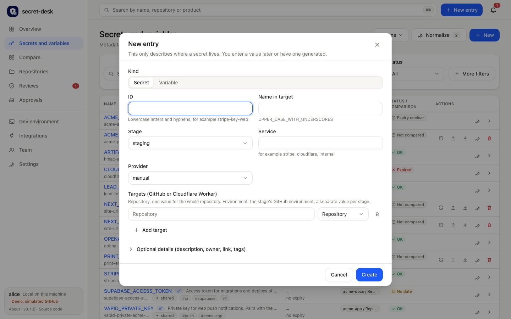

A secret opens its own page: description and parameters on the left, facts and targets in GitHub on the right. **Generate new value**, **Paste value** and **Show plan only** are in the page header. The review history shows the three newest checks; older ones are behind *Show N older reviews*.

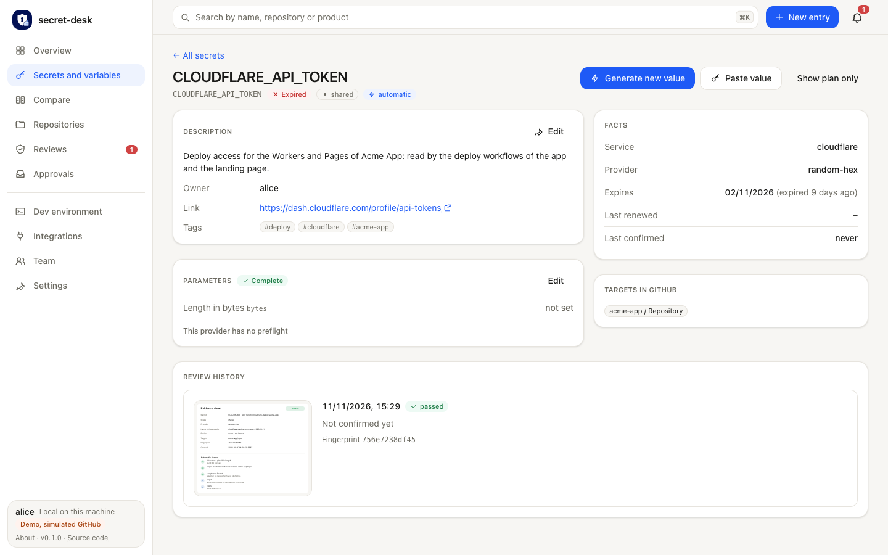

*Kind: Variables* shows the same list with the expected value and the comparison against GitHub.

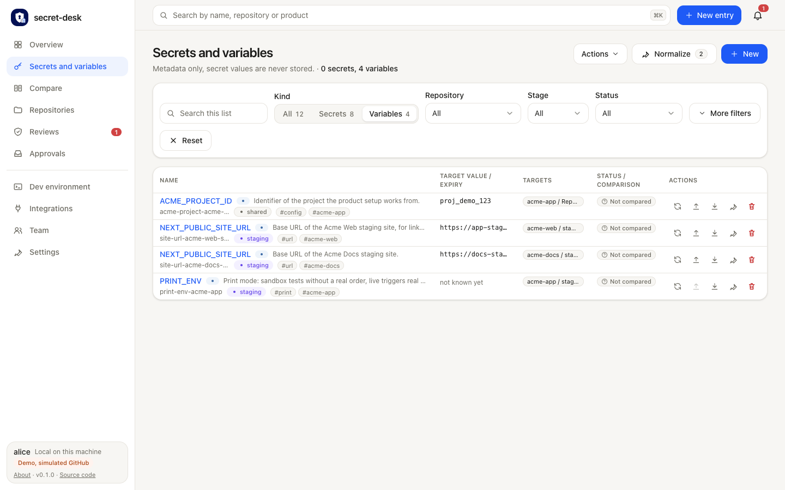

Phone width: [entries at 375 px](images/entries-375.png) (the filters are collapsed behind one *Filters* button next to the search), [overview at 375 px](images/overview-375.png).

## Compare

What you do here: see which names exist on which stage and where something is missing.

Main action: **Write everything to GitHub** in the page header, next to **Copy as Markdown**. The toolbar has the live toggle *Check live against GitHub* with its status (*Inventory only* or *Live state from GitHub*), repository and type selects, name search, the compared-stage chips and the checkboxes *Deviations only*, *Gaps first* and *Normalize names*. A compact strip under the toolbar counts expected, present, missing and unexpected per stage. Turn the live toggle on to read GitHub; more options appear in the toolbar. Details: [COMPARE.md](COMPARE.md).

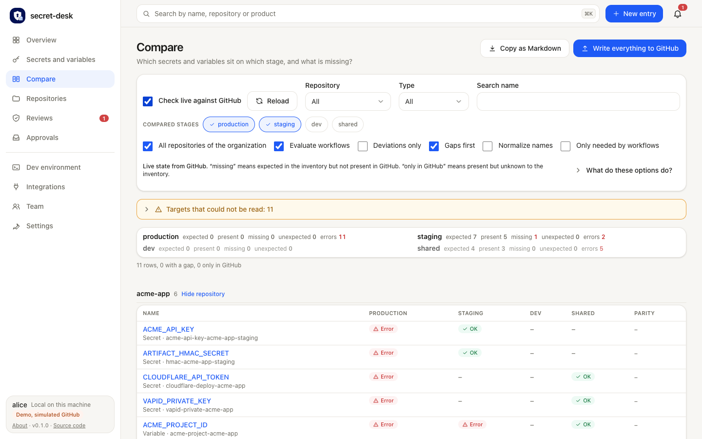

Phone width: [compare at 375 px](images/compare-375.png) (the toolbar stacks into one column).

## Repositories

What you do here: link each repository to a folder on this machine, so the dev environment knows the path.

Main action: *Link* in a row; **Find locally** and **Compare with GitHub** are in the page header. Details: [REPOSITORIES.md](REPOSITORIES.md).

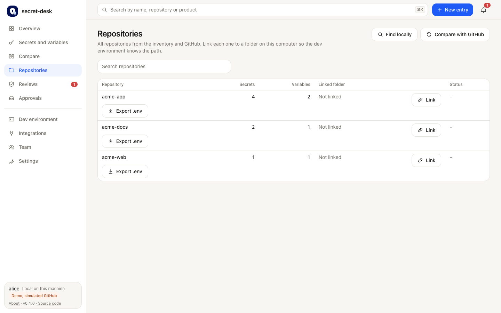

## Reviews

What you do here: check a new value before it goes to GitHub. The list shows every open review with its stage, result and the time left.

Main action: open a review. On its page the evidence image and the automatic checks are on the left; the decision card is on the right. Tick every checklist item, then use **Confirm and write to GitHub**. **Reject and delete new value** is next to it. Both are in an action bar that stays in view while you scroll.

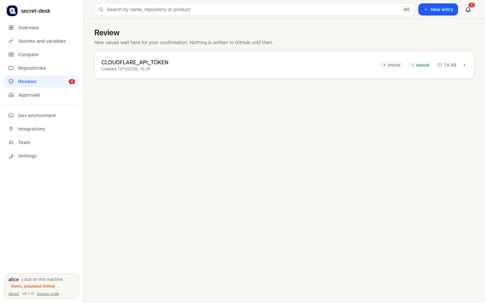

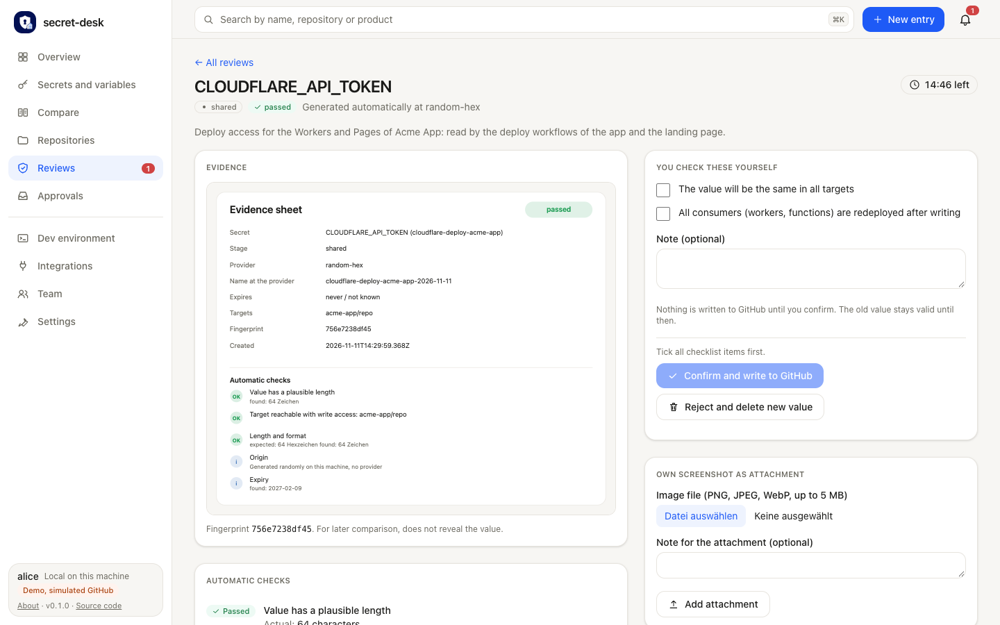

## Approvals

What you do here: decide on requests from AI agents that need a person. The list is empty until an agent asks for something outside its allowed stages. Details: [AGENTS.md](AGENTS.md).

Main action: *Approve* or *Deny* a request in the list.

## Dev environment

What you do here: write a working `.env.local` for a repository from its dev template. Only the path and key names are shown, never values.

Main action: **Generate file** on each repository card. A card starts with the file path, your own inputs (marked *optional* or *input required*) and the overwrite checkbox. The list of keys is a closed section with a count, for example "3 keys · your input needed for 1". **Export .env** at the top is one row: pick a repository and download its variables for a stage. Details: [DEV-ENV.md](DEV-ENV.md).

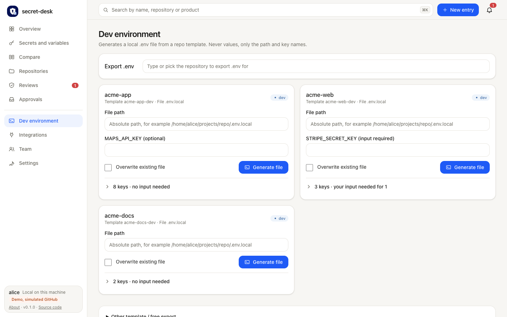

Phone width: [dev environment at 375 px](images/dev-env-375.png) (one repository card open at a time, like an accordion).

## Integrations

What you do here: connect GitHub and the providers, and see what works.

Main action: **Add integration** in the page header; **Expand all** is next to it. The *Live check* is one compact bar with a status badge, *Details and explanation* and **Check now**; the details open by themselves when something failed. Provider cards are a grid with a category label on each card. The buttons for the next step (*Set up*, *Connect with sign-in*) are in the card header. Details: [INTEGRATIONS.md](INTEGRATIONS.md).

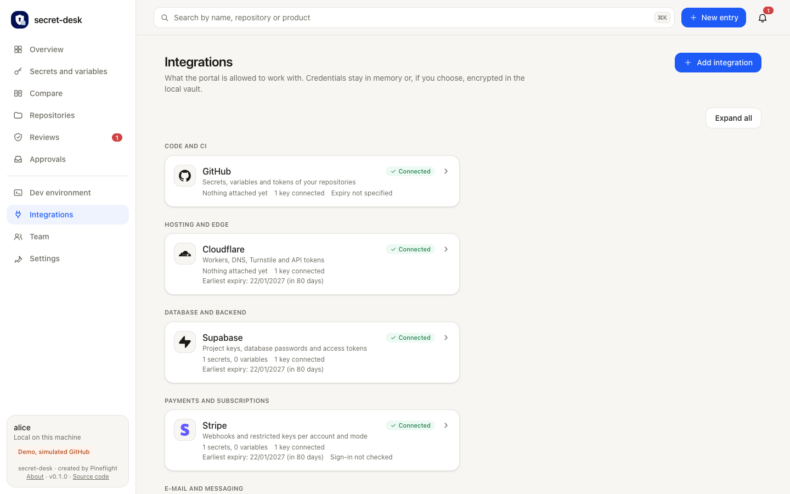

With every card open:

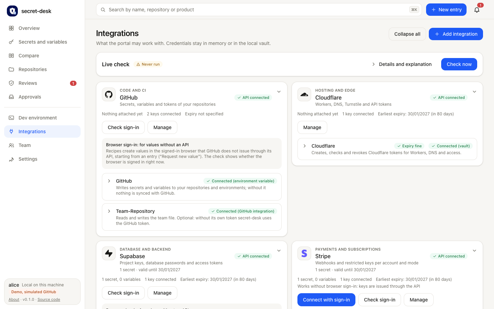

*Add integration* opens a picker with one tile per provider, grouped by category, and a search field.

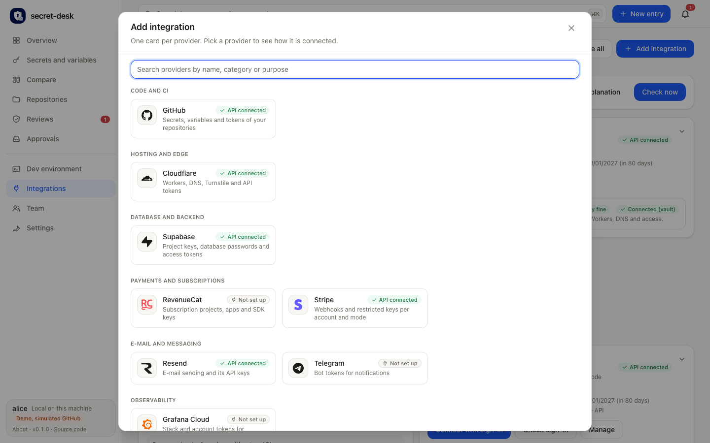

## Team

What you do here: share the configuration without values, either through a private GitHub repository or as a file.

Main action: **Sync now** in the header row of the *Team sync with GitHub* card (on the right of the row from a wide window up), plus **Create pull request** or **Push to repo** in push mode. The last sync is shown as date and time in your language. Without a setup the card offers **Set up**. Confirm buttons of a check or a push are above the difference. The team token is one status line with *Manage token*. *File exchange* holds the download and the import. Details: [TEAM.md](TEAM.md).

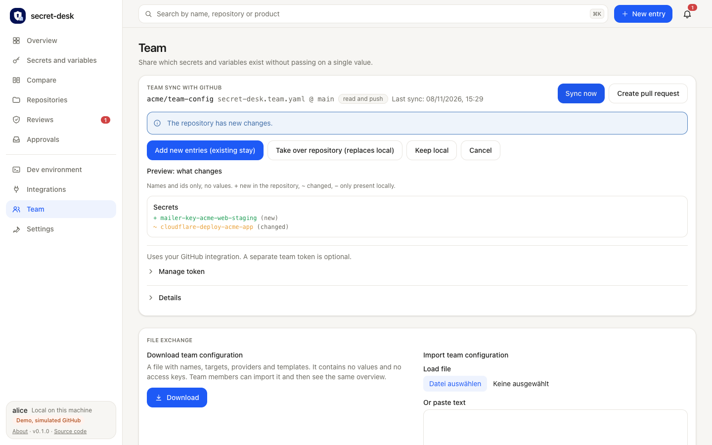

After **Create pull request** the push plan has its confirm button above the difference: [push plan](images/team-push.png).

## Settings

What you do here: manage stages, the agent policy, storage and automation, the language and developer tools. The tabs are at the top.

Main action: **Add stage** on the *Stages* tab. Details: [STAGES.md](STAGES.md).

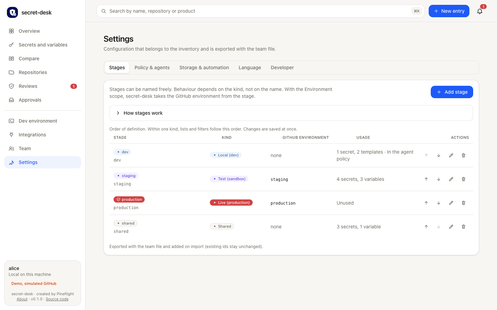

## First start

When the inventory is empty, the welcome page offers one choice of three ways in: *Load from GitHub*, *Upload a file* or *Start empty*. Only the panel you choose is shown. *Load from GitHub* lets you pick repository, branch, file and mode from lists and shows a preview before anything is taken over. Details: [TEAM.md](TEAM.md#choose-the-repository-from-lists).

Main action: the button of the chosen panel (*Load preview*, *Apply*, *Start empty*).

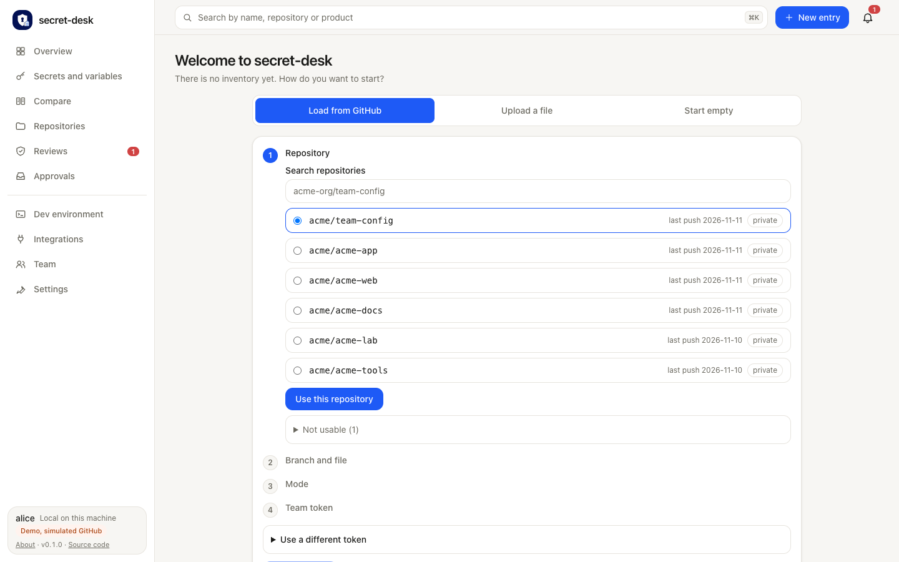
