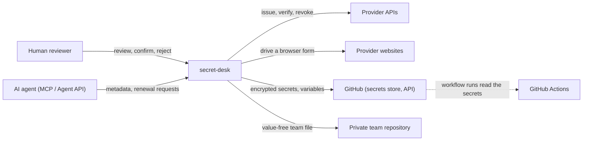

# 3. Context and scope

*Purpose: the system boundary and every external system it talks to · Audience: all · As of 2026-11-07 · Sources: [`ROADMAP.md`](../ROADMAP.md), [`PROVIDERS.md`](../PROVIDERS.md), [`INTEGRATIONS.md`](../INTEGRATIONS.md), [`AGENT-API.md`](../AGENT-API.md), [`BROWSER-AUTOMATION.md`](../BROWSER-AUTOMATION.md)*

## 3.1 Business context

| Partner | Role | Data in | Data out |
|---|---|---|---|
| Human reviewer | Starts a renewal, ticks the review items, confirms or rejects | Review report, evidence image | Decision, optional own screenshot, notes |
| AI agent | Reads overview and metadata, requests renewals, edits inventory metadata | Names, status, report metadata (never values) | Requests, metadata patches ([AGENTS.md](../AGENTS.md)) |
| Provider APIs | Create, check and revoke tokens | Token names, permissions, resource ids | New value, provider id, expiry |
| GitHub | Target of secrets and variables | Names, sealed values, variable values | Names, metadata, public keys, workflow files |

## 3.2 Technical context

| External system | Protocol | Why | What is exchanged | Documented in |
|---|---|---|---|---|
| GitHub REST API | HTTPS, bearer token (PAT or GitHub App installation token) | Read names and public keys, write encrypted secrets and variables, read workflow files (optional) | Names, sealed-box values, variable values | [INTEGRATIONS.md](../INTEGRATIONS.md#github) |
| Provider APIs as listed in PROVIDERS.md (for example Cloudflare, Supabase, Stripe, Resend, Grafana Cloud, OpenAI, Anthropic, RevenueCat) | HTTPS, per-provider connection token | Create, verify and revoke tokens; read resources for parameters | Token names, permissions, account/zone/project ids; the new value comes back once | [PROVIDERS.md](../PROVIDERS.md), [ROADMAP.md](../ROADMAP.md) |
| Cloudflare Workers script secrets | HTTPS | Worker places as an additional write target | Secret per deployed Worker script (names only come back) | [`worker-secrets.ts`](../../packages/core/src/worker-secrets.ts) |
| Provider websites (browser recipes) | Chrome DevTools Protocol via `playwright-core`, local Chrome or a remote browser sidecar | Create tokens where no API exists | What the recipe types into the provider's own form; with the guided sign-in the email and password the human entered for that run | [BROWSER-AUTOMATION.md](../BROWSER-AUTOMATION.md), [RECIPES.md](../RECIPES.md) |
| Agents | Stdio MCP server (`packages/mcp`) that calls the loopback HTTP Agent API with a bearer token | Metadata and renewal requests | JSON per [openapi-agent.yaml](../openapi-agent.yaml) | [AGENT-API.md](../AGENT-API.md), [AGENTS.md](../AGENTS.md) |
| Other systems (issue trackers, CI, scripts) | Integration API; implemented today as read of metadata plus renewal requests on `/api/agent`, a versioned base path is *planned* | Status for other tools | JSON per [api/openapi.yaml](../api/openapi.yaml) | [INTEGRATION-API.md](../INTEGRATION-API.md) |
| Private team repository (optional) | GitHub contents API, optional pull requests | Share the value-free configuration | Inventory metadata, never values | [TEAM.md](../TEAM.md#team-sync-with-a-private-github-repository) |
| 1Password CLI `op` (optional) | Local process, `execFile` | Resolve `op://` references for connection tokens | Token read once per use | [SECURITY-MODEL.md](../SECURITY-MODEL.md#provider-access-tokens) |
| OS keychain (macOS Keychain, `secret-tool`, Windows DPAPI) | Local processes via stdin | Protect the vault key | A 32-byte key | [SECURITY-MODEL.md](../SECURITY-MODEL.md#file-permissions-and-platforms) |
| Container registry (ghcr.io) | OCI | Distribute the portal image | Multi-arch image | [chapter 7](07-deployment-view.md) |

## 3.3 Scope boundary

Inside the system: the portal, CLI, MCP server, the provider modules, the recipe engine and the files under
`~/.secret-desk/`. Outside: the providers, GitHub, the user's browser profile at the provider, and the hosts that
run the workflows which consume the secrets. secret-desk has no server of its own and no user accounts
([DOCKER.md](../DOCKER.md)); the portal protects access with a launch secret, a session cookie and a CSRF token
([SECURITY-MODEL.md](../SECURITY-MODEL.md#access-to-the-portal)).
