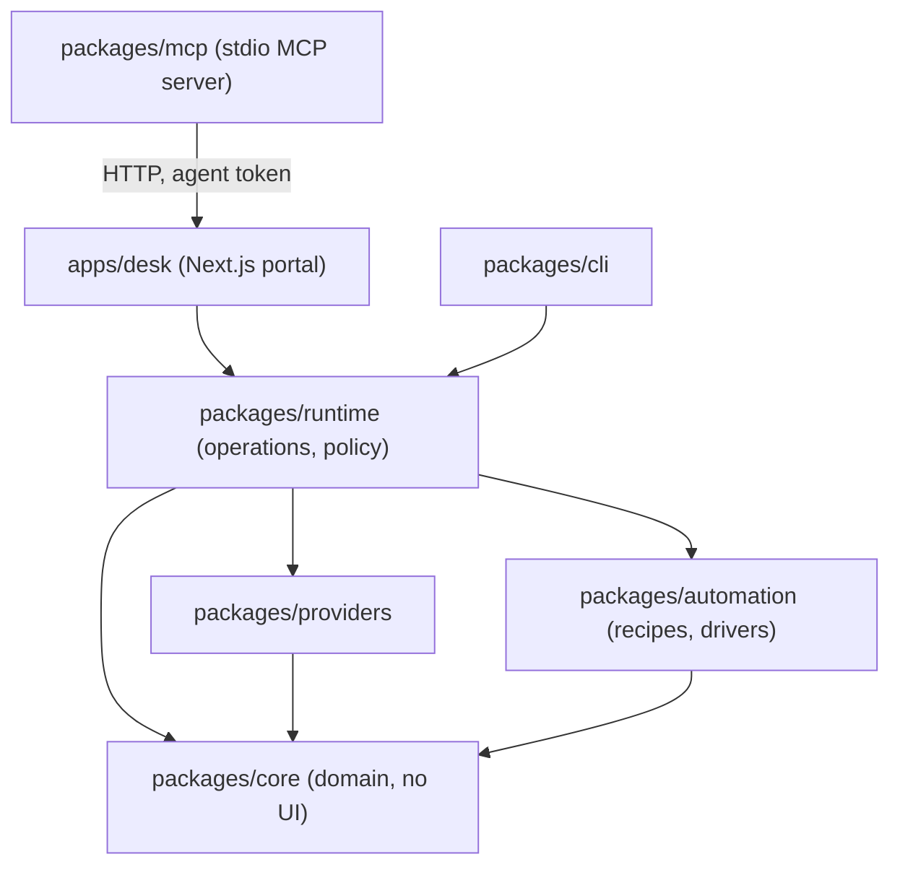

# 5. Building block view

*Purpose: packages, apps and their responsibilities and interfaces · Audience: contributors · As of 2026-11-07 · Sources: [`ARCHITECTURE.md`](../ARCHITECTURE.md#packages), [`pnpm-workspace.yaml`](../../pnpm-workspace.yaml), `packages/*/src`, `apps/desk/src`*

## 5.1 Level 1: workspace

| Block | Responsibility | Main interfaces | Code |
|---|---|---|---|
| `packages/core` | Inventory, status, GitHub client, issuance and review flow, variables, compare, dev export, team file, vault, platform helpers | `InventoryStore`, `prepareIssuance` / `commitIssuance` / `discardIssuance`, `Provider`, `ProviderRegistry`, `SecretValue`, `GitHubClient`, `computeStatus` | [`packages/core/src`](../../packages/core/src) |
| `packages/providers` | Provider modules: Cloudflare (tokens, Access service tokens, R2 credentials, Turnstile), Supabase, Stripe, Resend, Grafana, OpenAI, Anthropic, RevenueCat, VAPID, random values, manual guides | Each module exports a `Provider`; the registry assembles them | [`packages/providers/src`](../../packages/providers/src) |
| `packages/automation` | Browser recipes (zod schema), template rendering, `runRecipe`, `BrowserDriver` (Playwright, CDP, fake), Chrome lookup, sign-in helpers | `RecipeSchema`, `loadRecipes`, `runRecipe`, `createBrowserProvider` (a `Provider`) | [`packages/automation/src`](../../packages/automation/src) |
| `packages/runtime` | Shared operations and policy for portal, CLI and MCP: `createRuntime`, agent actions, approvals, pending-issuance queue, compare, team sync, settings, guided sign-in facade | `Runtime`, `Actor`, `requestIssuance`, `confirmIssuance`, `rejectIssuance`, `IssuanceQueue`, `PolicyError` | [`packages/runtime/src`](../../packages/runtime/src) |
| `packages/cli` | Command line: `doctor`, `check`, `status`, `renew`, `vars`, `sync`, `env export`, `team`, `inventory`, `browser`, `vapid` | Commands per [CLI.md](../CLI.md) | [`packages/cli/src`](../../packages/cli/src) |
| `packages/mcp` | MCP server for AI agents; each tool wraps one Agent API call | `TOOLS` in [`tools.ts`](../../packages/mcp/src/tools.ts), `DeskClient` | [`packages/mcp/src`](../../packages/mcp/src) |
| `apps/desk` | The portal: UI pages, `/api/ui/*` and `/api/agent/*` router, request security (Host, Origin, CSP, session, CSRF), OpenAPI | `router.ts`, `security.ts`, `desk.ts` | [`apps/desk/src`](../../apps/desk/src) |
| `recipes/` | Bundled browser recipes as YAML | `RecipeSchema` | [`recipes/`](../../recipes) |
| `skills/secret-desk` | Skill that teaches agents to use the tools | n/a | [`skills/`](../../skills) |
| `examples/` | Example config, inventory, MCP config, expiry workflow | n/a | [`examples/`](../../examples) |
| `docker/browser` | Browser sidecar image (Chromium on a virtual display, noVNC, DevTools) | Port 6080 noVNC, 9222 DevTools (compose network only) | [`docker/browser`](../../docker/browser) |

Dependency rule (visible in the `@secret-desk/*` dependencies of each `package.json`): `core` depends on no other package; `providers` and `automation` depend only on `core`; `runtime` on those three; `cli` and `apps/desk` on `runtime`. `packages/mcp` has no workspace dependency: it talks HTTP to the portal.
The portal and the MCP server speak to the same routing layer ([ARCHITECTURE.md](../ARCHITECTURE.md#packages)).

## 5.2 Level 2: core

| Area | Files | Role |
|---|---|---|
| Secret handling | `secret.ts` | `SecretValue` hides the value from `toString`, JSON and `util.inspect`; `redact` removes known values from text |
| Issuance | `issuance.ts`, `snapshot.ts`, `evidence.ts`, `verification.ts` | Stage machine, binding to the reviewed state, report and evidence image, checks |
| Provider contract | `provider.ts`, `params.ts`, `preflight.ts` | `Provider` interface, parameters, read-only preflight |
| Inventory | `inventory.ts`, `types.ts`, `normalize.ts`, `patch.ts` | Document, locked save with replay, conflict error |
| Status and compare | `status.ts`, `compare.ts`, `workflow-needs.ts` | Expiry levels, matrix across stages and repositories |
| GitHub | `github.ts`, `github-sync.ts`, `worker-secrets.ts`, `place-io.ts` | Sealed-box writes, variables, environments, Worker secrets |
| Local safety | `vault.ts`, `platform.ts`, `guards.ts`, `env-export.ts` | Encrypted vault, file modes and paths, secret guard for variables, `.env` export |
| Team | `team.ts`, `team-sync.ts` | Value-free export, sync with a private repository |

## 5.3 Provider interface

`Provider` ([`provider.ts`](../../packages/core/src/provider.ts)) has `id`, `label`, `kind` (`automatic` or
`manual`) and optional `connection`, `guide`, `params`, `discover`, `preflight`, `issue`, `verify`,
`reviewChecklist`, `revoke`, `readOnly`, `companionParams`. `issue` returns an `IssuedSecret` (value, optional
companion values for other entries, expiry, provider id). `verify` returns checks only, never values.
The interface is the extension point described in
[DEVELOPING-INTEGRATIONS.md](../DEVELOPING-INTEGRATIONS.md#1-which-parts-does-a-provider-need).

## 5.4 Stage machine

States of one renewal, by function in `issuance.ts` (see chapter 6): `prepareIssuance` creates a
`PendingIssuance` (in memory); `commitIssuance` writes, re-checks, revokes and records; `discardIssuance` deletes
the new value at the provider. `IssuanceQueue.sweep` discards expired pending issuances; the portal runs it every
60 seconds ([`desk.ts`](../../apps/desk/src/server/desk.ts)).
