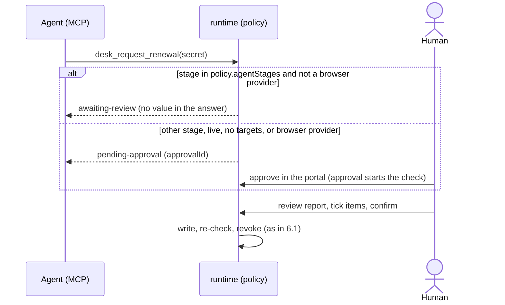

# 6. Runtime view

*Purpose: the scenarios that matter at runtime · Audience: contributors, reviewers · As of 2026-11-07 · Sources: [`ARCHITECTURE.md`](../ARCHITECTURE.md#the-path-of-a-new-value), [`issuance.ts`](../../packages/core/src/issuance.ts), [`agent-api.ts`](../../packages/runtime/src/agent-api.ts), [`AGENT-API.md`](../AGENT-API.md), [`TRIAL-RUN.md`](../TRIAL-RUN.md), [`CLI.md`](../CLI.md)*

## 6.1 The path of a new value (happy path)

```mermaid
sequenceDiagram
  actor H as Human
  participant D as Portal / runtime
  participant P as Provider API
  participant G as GitHub
  H->>D: "Generate new value"
  D->>P: issue (create token)
  P-->>D: value, provider id, expiry
  D->>P: verify (active, permissions, expiry, mode)
  D->>G: check every target is reachable with write access
  D-->>H: review report + evidence image (value stays in memory, max 15 min)
  H->>D: tick all review items, confirm
  D->>G: write sealed value to every target
  D->>G: re-check: name exists and was just changed
  D->>P: revoke old value
  D->>D: record rotatedAt, expires, verifiedAt, verifiedBy; store report
```

Steps (functions in `issuance.ts`): `prepareIssuance` creates and verifies and writes nothing;
`commitIssuance` requires every checklist item ticked and no failed automatic check (unless `force`), then writes,
re-checks, revokes and saves the inventory (`InventoryStore.save`, chapter 8); `discardIssuance` deletes the new value at
the provider again. Reject, timeout (15 minutes) and a changed entry all end in `discardIssuance`.
Detail and companion values: [ARCHITECTURE.md](../ARCHITECTURE.md#the-path-of-a-new-value).

## 6.2 Expiry detection and notification

1. `computeStatus` ([`status.ts`](../../packages/core/src/status.ts)) derives a level per entry from its `expires` date: `ok`, `soon`, `due`, `expired`, `no-date`, `missing`, `unknown`.
2. The portal shows the levels on the overview. The CLI `check` evaluates the inventory **offline** and exits `1` for `expired` or `due` ([CLI.md](../CLI.md#check)).
3. Notification is a scheduled GitHub workflow built from the template [`examples/workflows/secret-desk-expiry.yml`](../../examples/workflows/secret-desk-expiry.yml): daily, it runs `check --json` and opens one GitHub issue per finding if none is open for that key. The template is an example the user adds to a repository; secret-desk itself does not send messages.

## 6.3 Agent-driven issuance with human confirmation



Rule source: `requestIssuance`, `agentMayRunNow` and `resolveApproval` in [`agent-api.ts`](../../packages/runtime/src/agent-api.ts), [AGENT-API.md](../AGENT-API.md#approvals-and-policy).
An approval is bound to the entry's content at request time and becomes `stale` if it changes. Approvals live in
memory and vanish on restart. An agent can never confirm, reject, enter a value or read evidence images
(`requireHuman`).

## 6.4 Trial run

A guided first run with real services in a throwaway repository: build, `doctor` pre-check (reads only), start the
portal, walk an acceptance checklist (random value, a real provider, revoke of the old value, reject, manual paste,
variables, dev `.env`, optional agent), then clean up. Procedure and checklist: [TRIAL-RUN.md](../TRIAL-RUN.md).
It is the intended first contact with each provider because several endpoints are verified only against mocks
([PROVIDERS.md](../PROVIDERS.md)).

## 6.5 Failure: a target is unreachable or a write fails

| Where | What happens | Code |
|---|---|---|
| At review time (`prepareIssuance`) | The target check fails with `Ziel nicht erreichbar` (quoted UI text, status `fail`). The report shows it, confirm is refused until the cause is fixed or `force` is used. | `checkPlaceWritable` in `issuance.ts` |
| At confirm time, one or more writes fail | The result is `ok: false`; `partial: true` if some targets succeeded. **The old value is not revoked** and stays valid; the review stays open and is not saved as confirmed. Targets already written keep the new value. | `commitIssuanceOnce` |
| Re-check cannot read a target | Check becomes a `warn` (`Nachpruefung nicht moeglich`), the flow continues. | `issuance.ts` |
| Revoking the old value fails | A `warn` check is added; the new value is already live. | `issuance.ts` |
| Inventory save fails after writing | The result carries warnings: new provider id, reason, "enter the inventory by hand". | `issuance.ts` |
| Entry changed between review and confirm | `StaleIssuanceError`: the new value is revoked at the provider, nothing is written. | `snapshot.ts` |
| Provider API unreachable at issue time | Errors are sanitised (`ProviderError` without token); nothing was created. | [`http.ts`](../../packages/providers/src/http.ts) |

Known weak point: a partial write leaves targets inconsistent until a human retries (chapter 11, R-05).
