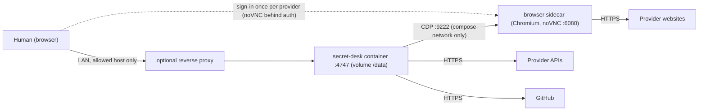

# 7. Deployment view

*Purpose: where the building blocks run and how they are released · Audience: operators, contributors · As of 2026-11-07 · Sources: [`Dockerfile`](../../Dockerfile), [`docker/browser`](../../docker/browser), [`DOCKER.md`](../DOCKER.md), [`CONFIGURATION.md`](../CONFIGURATION.md), [`.github/workflows`](../../.github/workflows), [`README.md`](../../README.md#docker)*

No cloud service and no server of its own: secret-desk runs where the human runs it. The same code serves three
setups. Frameworks and runtimes: see the lockfile and release notes ([chapter 2](02-constraints.md)).

## 7.1 Environments

| Environment | Build unit | Who | Browser automation | Vault key |
|---|---|---|---|---|
| Local run (macOS, Linux, Windows) | `pnpm dev` (portal), `secret-desk` CLI, MCP server over stdio | One developer | Local Chrome, Chromium or Edge, visible window | OS keychain, or `SECRET_DESK_VAULT_KEY` / `vault.keyFile` |
| Container on a small always-on host (a Raspberry Pi class machine, arm64, or amd64) | Image from the `Dockerfile` | A team in a trusted LAN | Browser sidecar container (`docker/browser`) reached over the DevTools protocol | `SECRET_DESK_VAULT_KEY` (no keychain in a container) |
| CI (GitHub-hosted runners) | Workflows below | Maintainers | Not used | Not used |

There is no staging or production environment of secret-desk itself: it is a tool the user runs, not a hosted
service. The system it manages has its own stages ([STAGES.md](../STAGES.md)).

## 7.2 Container topology (intended deployment)

| Element | Notes | Source |
|---|---|---|
| Portal container | `node:24-slim`, runs as user `node`, `HOME=/data`, volume `/data`, `next start -H 0.0.0.0 -p 4747`. The port is published to the host loopback or one LAN address only; `SECRET_DESK_ALLOWED_HOSTS` must list that address. | [`Dockerfile`](../../Dockerfile), [DOCKER.md](../DOCKER.md) |
| Launch secret | Created at start and printed to the log; optionally persisted via `SECRET_DESK_LAUNCH_SECRET_FILE` (permanent secret on disk, a trade-off). | [DOCKER.md](../DOCKER.md#find-the-launch-address) |
| Browser sidecar | Headed Chromium on a virtual display. Port 9222 gives full control of a signed-in browser: compose network only, never published. Published only when `docker/browser` changes. | [BROWSER-AUTOMATION.md](../BROWSER-AUTOMATION.md#remote-browser-headless-host), [`release.yml`](../../.github/workflows/release.yml) |
| Updates | Optional Watchtower on `:latest`. | [DOCKER.md](../DOCKER.md#automatic-updates-with-watchtower) |
| Access | No user accounts: publish to a LAN only, never to the internet. | [DOCKER.md](../DOCKER.md) |

Not available in the plain container: browser automation without the sidecar and the OS keychain
([DOCKER.md](../DOCKER.md#what-does-not-work-in-a-container)).

## 7.3 Where state lives

| State | Location | Contains values? |
|---|---|---|
| Inventory | `inventory.yaml` (may be in Git) | No, metadata and configuration only |
| Review reports and attachments | `.secret-desk-evidence/` (not in Git) | No, fingerprints and images |
| Integration tokens | `~/.secret-desk/vault.json` (AES-256-GCM) | Provider tokens, encrypted; key in the keychain, never beside the data |
| Folder links, agent token, browser profile | `~/.secret-desk/` | Agent token and browser cookies, mode 600 / 700 |
| Pending issuances, approvals, session tokens | Process memory | New values for at most 15 minutes; lost on restart |
| Team sync state | `.secret-desk-team-sync.json` | Blob SHA, hash, timestamps |

Full file list and modes: [CONFIGURATION.md](../CONFIGURATION.md#files-secret-desk-writes). In the container
`HOME=/data`, so `~/.secret-desk` lives on the volume.

## 7.4 CI/CD path

| Workflow | Trigger | What it does |
|---|---|---|
| [`ci.yml`](../../.github/workflows/ci.yml) | pull request, push to `main`, manual | `verify` job on `ubuntu-latest`: install with frozen lockfile, `pnpm run verify` (value scan, build, typecheck, tests), licence check, value scan. On pull requests a `docker-build` job builds the image for `linux/amd64` without publishing. |
| [`cross-platform.yml`](../../.github/workflows/cross-platform.yml) | **manual only** | Install, build, typecheck, test on a matrix of `ubuntu-latest`, `macos-latest`, `windows-latest`. |
| [`release.yml`](../../.github/workflows/release.yml) | push to `main` | Verify, build the portal image per platform (amd64, arm64), publish a multi-arch manifest to ghcr.io, create a GitHub release tagged `<package.json version>-<run number>`. The browser sidecar is built only if `docker/browser` changed. |

Third-party actions are pinned by commit SHA. Releases are created automatically on each merge to `main`
([chapter 11](11-risks-and-technical-debt.md), R-07, for the consequence).
